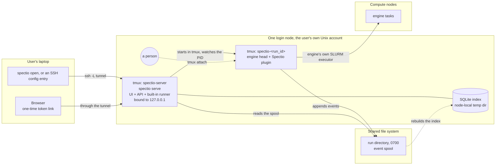

# Spectio — development environment, automation and testing

Status: draft v0.1 · 2026-10-25 · author: Thomas Weber (with Claude)
Companion docs:
- [`schedulers-and-monitoring.md`](schedulers-and-monitoring.md): what is tested against SLURM and Kubernetes.
- [`architecture-plugins-and-packaging.md`](architecture-plugins-and-packaging.md): packages, plugin conformance suites, deployments.
- [`admin-and-operations.md`](admin-and-operations.md): backup compatibility tests.
- `docs/playbooks/next-phase.md`: the order in which this is built.

## 0. Decisions in brief

1. **Agents check their own work against real tools.**
   - Every behaviour Spectio relies on is tested against the real tool at a pinned version: Nextflow, Snakemake and its executor plugins, Slurm, Kubernetes and Kueue.
   - Mocks are for unit tests only.
   - Real outputs are recorded as golden fixtures, with the tool version in the file name.
2. **Local clusters, no real HPC needed for development.**
   - SLURM runs in Docker with [sind](https://github.com/GSI-HPC/sind) (Slurm 25.11 and 26.05 images; slurmdbd; slurmrestd with JWT on the 26.05 images only, sind `0065750` `docs/content/guides/rest-api.md:36`; node power-cycle simulation; GitHub Action; MCP server; no privileged containers needed; LGPL-3.0, used as a tool, not linked).
   - Kubernetes runs in kind with Kueue installed.
3. **Scenarios are isolated and run in parallel.** Each has its own Compose project, port range, Docker network, sind realm or kind cluster, and data directory. Agents in parallel worktrees never collide.
4. **One bootstrap script everywhere.** `dev/bootstrap.sh` installs the pinned toolchain from `dev/versions.env` in:
   - the Claude Code cloud environment setup script, cached when it finishes in about 5 minutes;
   - CI;
   - a developer laptop.
   
   `dev/doctor.sh` proves each tool works.
5. **Dev previews without a server; a public instance only later, on EMBL Kubernetes** (revised 2026-10-26, §7). There is no staging VM, and the institute network is behind a VPN that GitHub cannot reach.
   - Every PR, validated wave and release is published as its own static preview on Cloudflare Pages. Nothing is overwritten, and a `/versions` page lists them all.
   - The full stack runs on demand in GitHub Codespaces, from a link on each PR.
   - The cost is 0 € within the free quotas.
   - The public instance for users comes at the beta, on EMBL's Kubernetes, deployed like depictio's.
6. **Claude is part of the development loop, inside guard rails:**
   - project agents and skills in `.claude/`;
   - PR review by those agents in GitHub Actions;
   - auto-fix of CI failures on PRs;
   - scheduled routines for drift checks.
   
   Merges follow [`documentation-system.md`](documentation-system.md#8-auto-merge) §8.

## 1. Toolchain (pinned in `dev/versions.env`)

`dev/versions.env` holds the exact value of every pin below, with the sha256 of every download and the digest of every image, and cites where each was read (step D3, 2026-10-27). This table says what is pinned and how it is installed; it does not repeat the values that change.

| Tool | Pin | How it is installed | Used for |
|---|---|---|---|
| Python | 3.13, an exact uv-managed patch (embeds SQLite ≥ 3.51.3; `dev/doctor.sh` checks it) | `uv python install --no-bin`, so the system `python3` is not shadowed | server, CLI, runner, tests |
| uv | the version pre-installed in cloud sessions (0.11.32 on 2026-10-27), so the cloud setup reuses it | release tarball at an explicit tag, sha256-checked, only when the found version differs | everything Python |
| Node.js | 24 LTS (maintenance until 2028-04-30); move to 26 once it is Active LTS (2026-10-28) ([Node release schedule](https://github.com/nodejs/Release/blob/main/schedule.json); v22 ends on 2027-04-30). Cloud sessions ship Node 22, so bootstrap installs 24 | `nodejs.org/dist` tarball, sha256 from its `SHASUMS256.txt` | UI build, Playwright, mermaid-cli |
| Java | 21 (Temurin) | a prerequisite, not installed by bootstrap: distro package, SDKMAN, `actions/setup-java` in CI; doctor checks the major | Nextflow |
| Nextflow | 26.10.x, 25.10.x and 25.04.x, the supported floor ([`architecture-plugins-and-packaging.md`](architecture-plugins-and-packaging.md) §13.4); all tested, and `nf-spectio`'s `requires` equals this range *(assumed — pending Thomas, inbox #28)* | bootstrap: the self-contained `nextflow-<ver>-dist` asset at an explicit tag, one per version (`nextflow` is the 26.10 one, `nextflow-<ver>` the others; offline-capable, still downloads plugins; [install docs](https://docs.seqera.io/nextflow/install)). The release publishes no checksum, so the sha256 is the one computed at download. Never `releases/latest`, which the cloud's GitHub proxy refuses ([spike D2](../research/spike-cloud-env-2026-10-26.md#network)). The `get.nextflow.io` launcher with `NXF_VER` pinned also works; it downloads `nextflow-<ver>-one.jar` from `www.nextflow.io/releases`. Plugins come from `registry.nextflow.io` (`PluginsFacade.groovy:48`). | fixture and nf-core runs |
| Snakemake | two versions, both tested: the minimum supported and the latest (9.27.1 today). Supported range: Snakemake ≥ 9.0 (the logger plugin interface arrived in 9.0.0, `CHANGELOG.md` at `1c67a66`; [`architecture-plugins-and-packaging.md`](architecture-plugins-and-packaging.md) §13.4) with `snakemake-interface-logger-plugins` `>=1.2,<3` (1.x and 2.x, the range snkmt also pins); the exact minimum tested version is set by R9 spike 2 **[to be validated]** *(assumed — pending Thomas, inbox #28)*. Plus `snakemake-executor-plugin-slurm`, `-kubernetes`, and `snakemake-logger-plugin-spectio` (ours); `-kueue` (0.1.0, the only PyPI release, 2024-01-03; repository unmaintained since 2024-03, HEAD `c09bf0d`; wheel says "under development") only if spike D2 shows it runs on Snakemake 9 **[to be validated]** | bootstrap: a venv from the hash-locked `dev/snakemake.lock.txt` (`uv pip sync --require-hashes`, see "Bootstrap" below), or a pixi environment | fixture runs |
| sind | latest release, pinned (v0.15.0 on 2026-10-27), with its node image and the mesh's CoreDNS image pinned by digest | release binary `sind-linux-amd64` at an explicit tag, sha256 from the release's `checksums.txt`; needs Docker ≥ 28 on cgroup v2 with `nsdelegate` (sind `README.md:40`, `pkg/doctor/run.go:123-168` at v0.15.0) | SLURM clusters |
| kind, kubectl, helm | pinned releases; the kind node image by the digest its release notes give | release binaries (helm: tarball), sha256 from each project's published checksum | Kubernetes clusters, chart tests; out of 0.0.1 ([decision log, 2026-10-27](../decisions/log.md#2026-10-27-001-revised-on-the-cluster-no-gates-a-token-link)), kept in the toolchain for T4 |
| Kueue | two pinned manifest versions: the newest supported Kueue minor (v0.20 at the time of R4) and an older one, both meant to run in `k8s-kueue`. Since T4, `k8s-kueue` runs the newest only (`KUEUE_VERSION`, read by `dev/k8s/cluster.sh` and `pipelines-k8s.yml`); the older one (`KUEUE_PREVIOUS_VERSION`) is pinned, not run yet. The older one is chosen to support the lowest targeted Kubernetes (1.33), with the kind node image pinned to match (Kueue v0.20.3 recommends Kubernetes 1.34 or newer, [install page](https://kueue.sigs.k8s.io/docs/getting-started/installation/)) **[to be validated: Kueue release supporting 1.33]** | `kubectl apply --server-side -f` | queueing scenarios |
| Playwright | the version whose Chromium cloud sessions ship under `/opt/pw-browsers` (1.63.0); another version would download a browser from a host off the allowlist | `npm install` into `$SPECTIO_HOME/npm`; Chromium downloaded only where it is missing (CI) | e2e tests, board rendering |
| mermaid-cli, mkdocs, mkdocs-material | pinned | on demand, never by bootstrap: `npx -y @mermaid-js/mermaid-cli@<pin>`, `uvx --with mkdocs-material==<pin> mkdocs==<pin>` | docs CI |
| Apptainer | pinned; installed on the sind submitter node *(assumed — pending Thomas, inbox #28)* | distro package | the Apptainer runtime axis on `slurm-site`, nightly (§5); whether Apptainer works in nested containers is **[to be validated]** |
| depictio | `DEPICTIO_VERSION`: the latest stable release, pinned (`v1.19.2` on 2026-10-26); never `next`, which also moves on betas, nor the force-moved `stable` git tag (depictio `build-images.yaml:280-282`, `bump-with-helm.sh:55-60`) *(decided — Thomas, 2026-10-27, inbox #22)* | container images `ghcr.io/depictio/depictio-{api,worker,viewer,cli}:<version>` | tier 5 hand-off tests |

**Bootstrap.** `bash dev/bootstrap.sh [--ci]` installs everything above that is not a prerequisite.
- **Where.** Each tool goes to `$SPECTIO_HOME/pkgs/<tool>-<version>/` (default `~/.local/share/spectio`), and its commands are linked into `$SPECTIO_BIN` (default `~/.local/bin`, which bootstrap also adds to `$GITHUB_PATH` in Actions). Snakemake and its plugins live in a venv named after their lock file.
- **Prerequisites,** checked and not installed: Docker, Java 21, `curl`, `tar`, `xz`, `sha256sum`. Linux x86_64 only, since the checksums are for linux/amd64.
- **Idempotent.** A tool already at its pin is not downloaded again; a second run takes about 1 s.
- **Checked downloads.**
  - Binaries and tarballs: against their sha256 in `versions.env`, before they are moved into place.
  - Snakemake, its plugins and all their dependencies: from `dev/snakemake.lock.txt` (`uv pip compile --generate-hashes`), installed with `uv pip sync --require-hashes`. A wrong hash stops the install ("Hash mismatch", checked 2026-10-27).
  - Playwright: from `dev/npm/package-lock.json` with `npm ci`, which checks each package's integrity hash.
  - Images named inside a pinned manifest are pinned by digest: the manifest is rewritten to `image@sha256:…` before `kubectl apply`. The Kueue v0.20.3 `manifests.yaml` is sha256-checked (`KUEUE_MANIFEST_SHA256`) but names its controller image by tag, `registry.k8s.io/kueue/kueue:v0.20.3` (L27290, checked 2026-10-28).
  - Nextflow plugins needed at run time (`nf-k8s` on 25.10, pinned by version only as `NF_K8S_25_10_VERSION`) are fetched by bootstrap from the plugin registry, checked against a sha256 in `versions.env`, and installed into the plugins directory, so that Nextflow does not download them during a run. Whether the registry publishes a checksum is **[to be validated]**.
  - CI jobs install only the tools they use, with `bootstrap.sh --only <tools>`; `pipelines-k8s.yml` runs the whole bootstrap today.
  - The last three rules are not built yet: the code is a follow-up with [inbox #46](../reviews/inbox.md#46-follow-up-pin-the-corpus-by-commit-and-replace-the-snakemake-composite-action).
  - Two downloads are not hashed by us: the uv-managed CPython, which uv fetches and checks against its own release metadata **[to be validated]**, and Playwright's Chromium where it is missing (CI), fetched over TLS from Playwright's CDN.
- **Parallel.** The installs run as background jobs, each with its own log in `$SPECTIO_HOME/logs/`; the script reports every job and exits non-zero if any failed.
- **`--ci`** also starts `dockerd` where nothing else will (root, no systemd, as in a cloud session, with `--registry-mirror=https://mirror.gcr.io`), then pre-pulls the doctor's images by digest. Docker Hub images come from `mirror.gcr.io` first, because Docker Hub rate-limits anonymous pulls on shared egress ([spike D2](../research/spike-cloud-env-2026-10-26.md#network); sind's own CI does the same, `.github/workflows/ci.yml` at v0.15.0). On cgroup v1 it skips the sind and kind images. It warns when it took more than 5 minutes.
- **Measured** on 2026-10-27: cold `--ci` run in 25 s in a cloud session (sind and kind images skipped), 56 s on an `ubuntu-24.04` runner (all images, Chromium downloaded with its system dependencies).

**Checks.**
- `dev/doctor.sh` prints each tool and its version against `dev/versions.env` (a different version fails), then runs one smoke test per layer:
  - `docker run --rm hello-world`, pinned by digest;
  - `sind create cluster` (a controller and a worker, node image by digest), then `sbatch --wait --wrap hostname`;
  - `kind create cluster` (node image by digest), then a Job that must complete, then delete;
  - `nextflow run tests/pipelines/synthetic/nextflow -profile test,local`;
  - `snakemake -n -s tests/pipelines/synthetic/snakemake/workflow/Snakefile`;
  - Playwright's Chromium opening `about:blank`.
- It exits non-zero on the first failure, naming the tool, and shows the end of that tool's output.
- **Skipped layers.** Where Docker runs on cgroup v1, as in a cloud session, the sind and kind layers print `skip` with the reason and the run still passes. `SPECTIO_DOCTOR_STRICT=1` turns a skip into a failure.
- **Isolation.** Each run uses its own sind realm and kind cluster, `spx-doctor-<pid>`, deleted on exit, so parallel runs do not collide (§5).
- **Where it runs.** In a cloud session (the exit check of step D3), and in `dev-env.yml` (§11) on an `ubuntu-24.04` runner with `SPECTIO_DOCTOR_STRICT=1`, so that sind and kind are proven there. A runner change cannot turn that job green by skipping them, as in sind's own CI (`.github/workflows/ci.yml`, "Check prerequisites", at v0.15.0).

**Dependency updates.** Renovate keeps every pin current: the uv lock, npm, GitHub Actions (pinned by commit SHA), Docker image digests, Helm dependencies and pre-commit hooks, plus regex managers for `dev/versions.env` and `tests/pipelines/real/corpus.yaml` (Renovate rather than Dependabot because of these regex managers **[to be validated: Dependabot has no equivalent]**). Updates arrive as grouped monthly PRs; security updates arrive as they are published. Every update PR goes through the `ci-ok` gate (§11). depictio runs Dependabot monthly for uv (two groups) and GitHub Actions (`.github/dependabot.yml` l.20-59 at `v1.19.2`), and its actions are at `checkout@v7`, `upload-artifact@v7`, `setup-uv@v7`; Spectio's workflows still use `checkout@v4`, `upload-artifact@v4`, `setup-node@v4`, `setup-uv@v6` and `github-script@v7`, and Node 20 actions face deprecation **[to be validated: date]**. Since D4 every action is pinned by full commit SHA with its version in a comment (zizmor's `unpinned-uses` audit enforces it, §11); the majors stay as they were until Renovate's first update PRs.

## 2. Where agents work

| Place | What it is good for | Limits to design around |
|---|---|---|
| **Claude Code on the user's machine** (terminal, desktop) | interactive work, plugins (superpowers, Karpathy guidelines, frontend-design) installed normally | the user's machine resources |
| **Cloud sessions** (claude.ai/code, `claude --cloud`) | parallel autonomous tasks, one per branch; Docker is available; engines, Compose and UI work | setup script cached only if it finishes in about 5 min; commands time out at 2 min by default (10 max, then moved to the background, up to 30 more min; `BASH_DEFAULT_TIMEOUT_MS` raises it); outbound network through an allowlist proxy (Trusted, Custom or Full); **plugins are not loaded**, so the skills are vendored in `.claude/skills/`; about 4 vCPU, 16 GB RAM, 30 GB disk; idle VMs are reclaimed ([cloud environments](https://code.claude.com/docs/en/cloud-environments.md), [cloud sessions](https://code.claude.com/docs/en/claude-code-on-the-web.md)). Measured by [spike D2](../research/spike-cloud-env-2026-10-26.md): a Firecracker VM with no swap; **cgroup v1**, so sind and kind cannot run (they run in CI, §1 "Checks"); Docker installed but its daemon not running, and not kept by the environment cache, which keeps files only; Docker Hub answers 429 to anonymous pulls; the GitHub proxy serves only the session's repositories, so downloads use explicit release tags; the auto-mode classifier refuses remote code such as `nextflow run <repo>` |
| **GitHub Actions** | PR gates, nightly matrix, preview deploys, Claude PR review | runner time and memory |
| **Cloudflare Pages** | one static preview per PR, wave and release (docs, boards, later the UI with a mocked API) | static only; public unless Cloudflare Access is on |
| **GitHub Codespaces** | the full stack on demand for Thomas, one per branch | about 60 h a month of a 2-core machine in the free quota; stops when idle |

**Cloud environment settings** (claude.ai/code → environment; written by step D3 from [spike D2](../research/spike-cloud-env-2026-10-26.md#recommended-custom-allowlist)):
- **Network access:** **Custom**, with **"Also include default list of common package managers"** checked, and these lines in **Allowed domains** (a leading `*.` matches every subdomain, [docs](https://code.claude.com/docs/en/cloud-environments.md#access-levels)):

  ```text
  nodejs.org
  get.helm.sh
  get.nextflow.io
  www.nextflow.io
  registry.nextflow.io
  nf-co.re
  quay.io
  *.quay.io
  community.wave.seqera.io
  cerbero.seqera.io
  community-cr-prod.seqera.io
  pkg-containers.githubusercontent.com
  registry.k8s.io
  *.pkg.dev
  prefix.dev
  *.prefix.dev
  ```

  - `nodejs.org` and `get.helm.sh` are what bootstrap needs beyond the default list (Node and helm downloads); D2's list predates bootstrap and lacked them. Everything else bootstrap fetches is in the default list (PyPI, npm, `dl.k8s.io`, `*.gcr.io` for the Docker Hub mirror, `ghcr.io`, `release-assets.githubusercontent.com`) or goes through the GitHub proxy ([default allowed domains](https://code.claude.com/docs/en/cloud-environments.md#default-allowed-domains), checked 2026-10-27).
  - The other lines are for nf-core containers (`quay.io`, Seqera), the Nextflow launcher and plugins, `nf-core` tooling, Kubernetes images and pixi.
  - Not checked yet **[to be validated]**: where Nextflow plugin downloads redirect to; whether `*.prefix.dev` and `*.pkg.dev` cover every host pixi and `registry.k8s.io` use. The spike ran on a broader access level, so the list must be re-probed once the environment is set to Custom (spike D2, follow-up 3).
  - The wildcards widen what a session can reach: anyone can host a registry under `*.pkg.dev`. At the re-probe, replace each wildcard with the exact hosts seen in the redirects, and drop the lines no scenario uses yet (security review of D3, SEC-D3-04).
- **Environment variables** (`.env` format, readable by everyone who uses the environment, so never a secret):

  ```text
  BASH_DEFAULT_TIMEOUT_MS=600000
  BASH_MAX_TIMEOUT_MS=1800000
  ```

  Both are in milliseconds and raise the 2-minute foreground default to 10 minutes ([time limits](https://code.claude.com/docs/en/cloud-environments.md#time-limits)). `CLAUDE_CODE_EXPERIMENTAL_AGENT_TEAMS=1` is optional.
- **Setup script:**

  ```bash
  #!/bin/bash
  # Spectio: pinned toolchain and pre-pulled images (docs/specs/dev-environment-and-testing.md §1).
  # Exits 0 even on failure: a failing setup script stops the session from starting.
  # It starts in /home/user, the parent of the clone, so it moves into the clone first.
  cd /home/user/spectio 2>/dev/null || true
  if [ -f dev/bootstrap.sh ]; then bash dev/bootstrap.sh --ci || true; fi
  ```

  - **Exit zero:** a setup script that exits non-zero stops the session from starting ([script requirements](https://code.claude.com/docs/en/cloud-environments.md#script-requirements)). If bootstrap fails, run `bash dev/bootstrap.sh --ci` in the session; its log names the failed job.
  - **Cached:** it took 25 s cold in a cloud session (§1 "Bootstrap"), far under the five minutes beyond which the environment is not cached. The cache keeps files and pulled images, and is rebuilt when the script or the network list changes, or after about seven days ([environment caching](https://code.claude.com/docs/en/cloud-environments.md#environment-caching)).
  - **Which pins:** the cache holds the pins of the branch the setup script ran on. A branch with other pins runs `bash dev/bootstrap.sh` itself (about 1 s when nothing changed).
  - **Where it runs:** the repository is already cloned, but the script starts in `/home/user`, the clone's parent, not in `/home/user/spectio`. Measured in the session of 2026-10-27 17:44 UTC from `/tmp/env-manager.log`: "Repository cloned successfully", then "Setting working directory" `/home/user`, then the 265-byte script of the first version of this section (without the `cd`) ran in 7 ms, so its `if` skipped bootstrap and the doctor failed on Python. The `cd` fixes that; the `if` keeps the script harmless if the clone is elsewhere.
- **Docker daemon:** not running at session start, and not kept by the cache. `dev/bootstrap.sh --ci` and `dev/doctor.sh` start it when it is missing, so no SessionStart hook is needed for it.
- **SessionStart hook:** none for now. Scenarios start their own clusters.

## 3. Fixture workflows (see §10.1)

The fixture workflows are the synthetic scenario pipelines of §10.1 (`tests/pipelines/synthetic/`): one twin per engine, three stages, two gates, the same failure injection. Real pipelines (nf-core/demo, the nf-core/rnaseq test profile) are in §10.2. *(assumed — pending Thomas, inbox #28)*

**Gate stop on real pipelines.** The `nf-core/rnaseq` and `nf-core/sarek` test profiles (Nextflow, local executor with Docker) check the gate stop on a real pipeline: a generated config stops after alignment through `ext.when`, then `-resume` without it; the cached-task count and the exit code are checked. Part of spikes T1/T2, before the walking skeleton. *(assumed — pending Thomas, inbox #28)* Pending: T1 did not run it; it moves to the nightly corpus *(assumed — pending Thomas, [inbox #47](../reviews/inbox.md#47-assumed-the-rnaseq-and-sarek-gate-stop-and-resume-check-moves-to-the-nightly-corpus))*.

**Failure injection.**
- *OOM, timeout, flaky:* §10.1 scenarios (`oom`, `oom_once`, `oom_real`, `timeout`, `flaky`). On a cluster, only a real allocation over the memory limit, which is what `oom_real` does, makes the scheduler report the kill: SLURM `OUT_OF_MEMORY` with `ConstrainRAMSpace=yes` (T3 probe `probe-oom`, `tests/fixtures/slurm/slurm-26.05.5/sacct-probes.json`), Kubernetes `OOMKilled` (T4, `tests/fixtures/k8s/failures-pods.json`). `oom` and `oom_once` kill their own process (exit 137), so SLURM records `FAILED 137:0` for Nextflow and `FAILED 1:0` for Snakemake, whose task job hides the tool's code (§10.1; [`schedulers-and-monitoring.md`](schedulers-and-monitoring.md) §3.5). No §10.1 scenario uses `oom_real` yet, on a cluster or locally.
- Cluster-level cases:
  - *Node failure:* sind cuts a worker's power during a running job (`sind power cut`, then `sind power on`); run in T3 (probe `probe-nodefail`, `NODE_FAIL`).
  - *Preemption:* planned, not built yet. T3 deferred it: it needs a higher-priority partition or QoS with preemption in `slurm-site`, which `dev/slurm/site.yaml` does not have. Who builds it: [inbox #60](../reviews/inbox.md#60-assumed-who-builds-the-deferred-slurm-coverage).

## 4. Local clusters

**Node tools are read-only for jobs.** Tools that cluster nodes execute come from a location the cluster's job user cannot write, so that a job cannot replace a tool that a later step of the same CI job runs, including the steps that write fixtures:
- on kind, a separate `extraMounts` entry with `readOnly: true` (kind `pkg/apis/config/v1alpha4/types.go:262` at v0.33.0);
- on sind, a second read-only mount **[to be validated: sind v0.15.0 storage options]**, or else the tools tree owned by root with no write bits.

The data directory stays writable for work directories. Today neither cluster does this: the sind nodes put `<data>/tools/bin` on `PATH` from the data directory, which every node mounts read-write and the job user owns (`dev/slurm/env.sh:8`, `dev/slurm/site.yaml:15-18`), and the kind nodes mount the whole repository, which task pods mount as a hostPath. The code is a follow-up for the step that next edits `dev/slurm/` and `dev/k8s/`.

### 4.1 SLURM with sind

| Profile | Topology | Used for |
|---|---|---|
| `slurm-mini` | controller + 1 worker (partition `htc`), no accounting, plus a submitter node where the engines run (`dev/slurm/cluster.sh up mini`, `dev/slurm/mini.yaml`) | the synthetic Nextflow `happy` scenario (T3). Planned, not built yet: head job, `squeue --json`, signal drain then cancel (`scancel --signal=TERM --full`, then a plain `scancel` after the grace period; one test per engine, spike T3) *(assumed — pending Thomas, inbox #28)*, runner restart while a head job runs, reconciled by `squeue --me --json` and the `spectio-head-` prefix filter (spike T3). Step page: [T3](../progress/W3/T3.md) |
| `slurm-site` | controller, db (slurmdbd), a submitter, `worker-[0-1]` in partition `htc` and `worker-2` in `bigmem` (`dev/slurm/cluster.sh up site`, `dev/slurm/site.yaml`); accounts `lab` and `capped` (`MaxJobs=1`) with `AccountingStorageEnforce=associations,limits`; `ConstrainRAMSpace=yes`; the maintenance reservation is created by the probes. Planned, not built yet: partition `gpu` with fake GRES | pending reasons, `sacct` outcomes, limits and failure classes, recorded as fixtures in `tests/fixtures/slurm/slurm-26.05.5/` by `tests/slurm/scenarios.sh` (T3); a Snakemake head submitted with `sbatch`. Planned: fairshare, pre-flight. Step page: [T3](../progress/W3/T3.md) |
| `slurm-rest` | `slurm-site` + api node (slurmrestd, JWT, 26.05; `dev/slurm/cluster.sh up rest`). sind writes the JWT key inside the containers; the token is made with `scontrol token` on the submitter and never leaves it | slurmrestd transport (T3: `ping` on `v0.0.43` to `v0.0.45`, `jobs`, `nodes`, `partitions`, `slurmdb/jobs` as fixtures) and `data_parser` negotiation |
| `slurm-versions` | `slurm-site` on 25.11 and 26.05 | version matrix; the 25.11 leg covers the CLI transport only (sind's 25.11 images have no slurmrestd). Planned, not built yet: T3 built `slurm-mini`, `slurm-site` and `slurm-rest` only; the first build step that needs the matrix builds it *(assumed — pending Thomas, inbox #60)* |

The runner runs on the sind submitter node as an unprivileged user, exactly as on a login node. Fixture workflows are mounted into it. Nextflow and Snakemake run inside the submitter node, using the cluster's `sbatch`. Note 2026-10-28: for 0.0.1 the end-to-end tests start each engine head in tmux on the submitter node, as on a login node (§15.3), with one cancel test per engine (an interrupt in the head's pane, then SIGTERM and SIGKILL) and a server restart while a head runs in tmux ([P1](../plans/P1-walking-skeleton.md) Tasks 22 and 23); the head-job items planned above stay for the later SLURM head launcher.

### 4.2 Kubernetes with kind

| Profile | Setup | Used for |
|---|---|---|
| `k8s-mini` | kind, 1 node (`dev/k8s/cluster.sh up mini`), the namespace `spectio-work` with a `ResourceQuota`, the repository mounted into the node at its own path so that task pods can mount it as a hostPath. The runner and engine-head Roles (`schedulers-and-monitoring.md` §4, as measured in `tests/k8s/rbac.yaml`) are applied by the scenarios, not by `up`. Planned, not built yet: SeaweedFS (S3) in the cluster | pod reasons, OOMKilled; the real pod and Job objects of a failed task (`state.terminated.reason`, pod `DeadlineExceeded`, Job `Failed` condition) captured as fixtures in `tests/fixtures/k8s/` (T4); the synthetic Nextflow pipeline on 25.10, which creates bare Pods. Planned, not built yet: the watch API and logs (runner code), and the Snakemake Kubernetes executor with `--default-storage-provider s3` against SeaweedFS (object storage is mandatory for it, architecture §7.5). Step page: [T4](../progress/W3/T4.md) |
| `k8s-kueue` | kind with 2 workers, Kueue with a `ClusterQueue` and a `LocalQueue`, the visibility API; Kueue `KUEUE_VERSION` only (§1) | built: queue positions and admission (T4, `tests/fixtures/k8s/kueue-workloads.json`, `kueue-pending-workloads.json`). Planned, not built yet: preemption, and the older Kueue version (§1). Step page: [T4](../progress/W3/T4.md) |
| `k8s-rwx` | `k8s-mini` + an RWX storage class (NFS provisioner) | Nextflow k8s executor with a shared work directory (Nextflow only; Snakemake needs S3) |

kind does not run inside a Claude Code cloud session: the VM's cgroup v1 layout stops the node's static pods ([spike D2](../research/spike-cloud-env-2026-10-26.md#result)), and the same layout stops sind (§4.1). Kubernetes and SLURM scenarios therefore run in CI and on the user's machine only; `dev-env.yml` proves both layers on every change to `dev/` (§1 "Checks").

## 5. Isolated, parallel scenarios

- **One command per scenario.** `dev/scenario.py up <scenario> [--id <n>]` creates:
  - Docker network `spx-<id>`;
  - Compose project `spx-<id>` with ports `20000 + 100·id + k`;
  - data directory `.scenarios/<id>/`;
  - sind realm `spx-<id>` or kind cluster `spx-<id>`.
  
  It prints a JSON with every URL and credential. `down` removes all of it.
- **Scenarios are YAML** (`tests/scenarios/*.yaml`): deployment (bundle / compose), scheduler profile, engine and version, fixture and parameters, gate script (who decides what, when), and expected events and states.
- **The matrix** is engine {nextflow 25.10, 26.10; snakemake minimum and latest (§1)} × scheduler {local, slurm-mini, slurm-site, k8s-mini, k8s-kueue} × runtime {docker, apptainer} (apptainer on `slurm-site`, nightly only; Spectio targets HPC, where Apptainer is the usual container runtime, and every scenario used Docker) *(assumed — pending Thomas, inbox #28)* × deployment {bundle, compose} × scenario {happy, gate-approve, gate-exclude-and-resume, oom-retry-suggestion, runner-offline-mid-run, restore-during-idle, multi-user-permissions}. A PR runs a smoke subset, the full matrix runs nightly. The cell snakemake × `k8s-kueue` is pending a spike (D2 install, T4 run): `snakemake-executor-plugin-kueue` 0.1.0 is an unmaintained prototype (§1); if it does not run, Snakemake on Kueue is tested with the `kubernetes` executor and Kueue's pod integration **[to be validated]**.
- **Parallelism is capped by memory,** checked against free RAM before `up`. One Claude agent per worktree and scenario ID, so agents working in parallel never share state.
- **Built in T5** ([Progress page](../progress/W3/T5.md)): `dev/scenario.py` (Python standard library only) with `up`, `down` and `list`, and three scenario files, `happy-local`, `happy-slurm-mini` and `happy-k8s-mini`. How it differs from the bullets above, until there is product code:
    - IDs are 1 to 99, so the ports stay under 65536; `up` without `--id` takes the lowest free one, claimed by creating `.scenarios/<id>/`, so two parallel `up` never get the same ID. `up` refuses an ID whose 100 ports are not all free on `127.0.0.1`.
    - The Compose project `spx-<id>` and its ports are reserved and reported in the JSON, not started: there is no Compose file yet. Port `k = 0` is kept for Spectio, and `k = 1` carries the kind API server of a Kubernetes scenario (kind `networking.apiServerPort`).
    - sind: the realm is `spx-<id>` and the cluster keeps its profile name (`mini`, `site`, `rest`), through `SIND_REALM` and `dev/slurm/cluster.sh`. The tools are bootstrapped into the scenario's data directory, which every node mounts (§4.1).
    - kind: cluster `spx-<id>`, with its kubeconfig in the data directory and its nodes on the scenario's network `spx-<id>` instead of kind's shared `kind` network, through `KIND_EXPERIMENTAL_DOCKER_NETWORK`, which kind 0.33.0 marks as unsupported (`pkg/cluster/internal/providers/docker/provider.go:72-76`); otherwise `down` would leave the `kind` network behind.
    - The scenario YAML is a small subset (`key: value`, `key: [a, b]`, `key:` followed by `  - item` lines, comments), and the fields are exactly `deployment`, `scheduler`, `engine`, `fixture`, `params`, `gate` and `expect`. Only `scheduler` is used: the rest waits for the runner and the gates.
    - The memory check compares a per-scheduler estimate (2 GiB for `slurm-mini` and `k8s-mini`, 4 to 4.5 GiB for the larger profiles) with `MemAvailable`. Idle, a `slurm-mini` realm used about 116 MiB and a `k8s-mini` cluster about 607 MiB (`docker stats`, run [40685163237](https://github.com/weber8thomas/spectio/actions/runs/40685163237)), so the estimates leave room for jobs and are not tuned. The check is not atomic across parallel `up`.
    - Isolation between scenarios (review fixes, [record](../reviews/code/T5.md)): the kind nodes mount the repository read-only and only the scenario's data directory read-write (kind `extraMounts[].readOnly`, [kind configuration](https://kind.sigs.k8s.io/docs/user/configuration/)); the API server listens on `127.0.0.1` only; `down` runs `sind`, `kind` and `docker` from the host `PATH`, never from the data directory that cluster jobs can write; a failed or interrupted `up` runs `down` for its ID; a `down` with a failed step keeps the data directory, so the ID stays claimed. Not built: an ownership check on `.scenarios/` and on the `spx-*` names (any local user who can run Docker can still act on them); symlink checks beyond a symlinked `.scenarios/` (`mkdir -p` in `cluster.sh` follows a symlinked data directory); a `work/` subdirectory as the only read-write mount, so the admin kubeconfig and `scenario.json` stay out of the nodes' reach. The read-only mount guards against mistakes, not against a hostile pod with hostPath on a privileged kind node. `up` owns the network `spx-<n>` before it may clean up by name, so a checkout never tears down another checkout's scenario.
    - Profiles not exercised by CI: `slurm-site`, `slurm-rest` and `k8s-kueue` are accepted by `dev/scenario.py`, but `scenarios.yml` brings up only `slurm-mini`, `k8s-mini` and `local`.
    - Not built: running the scenario (engine, gate script, expected events and states), the matrix, and the PR smoke subset. All of them need product code.
    - A scenario that runs Spectio will report its URL as `urls.spectio` (port `k = 0`) in the JSON; the end-to-end tests read that key (§6.1). `up` does not write it yet, because no scenario runs Spectio.

## 6. Test tiers

| Tier | What | Runs on | Gates |
|---|---|---|---|
| 0 · static | ruff, mypy on every package (`--strict` on `spectio-sdk`), import-linter (dependency rules), `pre-commit run --all-files`, eslint, OpenAPI diff, docs build, Mermaid | every push | PR |
| 1 · unit and contract | pure logic; plugin conformance suites (`spectio_sdk.testing`); golden fixtures for `nf-spectio` events, Snakemake logger events, `squeue` / `sacct` JSON and Kubernetes objects | every push, seconds | PR |
| 2 · component | server on SQLite and on Postgres 18, fake runner, recorded engine event streams replayed; API tests with RFC 9457 errors, `If-Match`, idempotency; the golden fixtures of every released bridge version replayed against the current server (compatibility window, [`architecture-plugins-and-packaging.md`](architecture-plugins-and-packaging.md) §12) *(assumed — pending Thomas, inbox #28)* | every push, < 2 min | PR |
| 3 · integration | real engines on `slurm-mini` and `k8s-mini`; backup → restore → migrate; bundle → Compose hand-over; two-replica tests on Postgres | PR (smoke subset), < 15 min | PR |
| 4 · end-to-end | Playwright against the bundle and Compose: launch, watch, review a gate, relaunch, admin pages, phone viewport | PR (smoke), nightly (full) | PR (smoke) |
| 5 · matrix and compatibility | the full scenario matrix; cross-version backup restore (previous release → current); depictio hand-off against the minimum depictio version `spectio-plugin-depictio` supports and the latest stable (`DEPICTIO_VERSION`, §1) *(decided — Thomas, 2026-10-27, inbox #22)*; in-place upgrades N-1 → N and N-3 → N (`upgrade.yml`, §11) | nightly / weekly | release |
| 6 · preview and instance | static preview: links and media checked on the deployed URL. Public instance, from the beta: deploy + Playwright smoke over its URL; inbound webhook round trip | after merge | release |

**Both databases.** Tiers 1 and 2 run on SQLite and on Postgres 18; tests marked `@pytest.mark.db(...)` name the dialects they need. This covers the Postgres-only paths (`FOR UPDATE SKIP LOCKED`, `LISTEN/NOTIFY`, advisory locks: [`architecture-plugins-and-packaging.md`](architecture-plugins-and-packaging.md) §7.2 and §7.6) and SQLite's Alembic batch mode. A migration test runs from an empty database and from each frozen backup fixture, on both dialects. The two-replica tests run on Postgres in tier 3. depictio's unit suite runs on mongomock and misses runtime-only regressions (`pyproject.toml:79-80,109-110` at `v1.19.2`).

**One type checker, one source of tool versions.** mypy gates every package from the first commit, with no narrowed paths, and `spectio-sdk` runs `--strict`. Pre-commit hooks are `language: system` and call the tools through `uv run`, so `uv.lock` is the only source of tool versions; tier 0 runs `pre-commit run --all-files`. depictio narrowed its ty gate to `depictio/models/` after about 280 diagnostics (`depictio-ci.yaml:242-250`), pins ruff `v0.15.16` in pre-commit but `ruff==0.16.1` in its dev dependencies, and has `pre-commit run --all-files` commented out in CI (`:252-255`).

**Safety nets.**
- A collection guard fails tier 1 when a `test_*.py` file is not collected (depictio's recipe tests were written but never run, because their directory was missing from `testpaths`: `pyproject.toml:293-297`).
- Diff coverage is reported on every PR, advisory for now, not a gate.
- Flaky tests are quarantined the way known engine faults are (§10.1): a `quarantine` marker, a linked issue, and a fix or removal within 2 weeks.
- Destructive end-to-end specs run last, in their own Playwright project (as depictio does: `playwright.config.ts:16-17,50-58,80-87`).

**Snakemake versions.** Tier 1 runs the logger interface's own suite (`snakemake_interface_logger_plugins.tests`) against `snakemake-logger-plugin-spectio`, and tier 2 replays the recorded Snakemake event streams, on both Snakemake versions of §1. Why: `DefaultFilter.__init__` changed signature three times within 9.x ("<=9.2.x … >=9.10.0 … >=9.23", FlowO 2.2.0 sdist, `plugin/client/log_handler.py:156-176`), and interface 2.1.0 (2026-05-20) added `needs_rulegraph`, which its `tests.py:114-116` asserts. A silent logger means no events, and so no gates. *(assumed — pending Thomas, inbox #28)*

**Exported crates.** Tier 2 validates every RO-Crate the export produces with `crs4/rocrate-validator`, against the version set pinned in [`api-and-data-model.md`](api-and-data-model.md) §10 (RO-Crate 1.1 + WRROC 0.5). `snakemake-report-plugin-rocrate` validates its crates the same way ([landscape note](../research/landscape-2026-10-26.md) §7).

**Visual review.** Playwright saves screenshots of the real pages named after the canvas boards (`RunDetail`, `ReviewQueue`…). A report puts them side by side with the renders of `design/ui-canvas`. This is a review aid for the `ux-reviewer` agent and for humans, not a pixel-diff gate.

### 6.1 End-to-end tests (`tests/e2e/`)

Built in T6 ([Progress page](../progress/W3/T6.md)), narrowed by the MVP decision of 2026-10-28 ([decision log](../decisions/log.md#2026-10-28-001-narrowed-launch-and-monitor-an-ultra-simple-ui)) (the first UI only launches and monitors runs): the smallest skeleton that the tier 4 tests will grow from.

- **Playwright in TypeScript,** `@playwright/test` pinned to `PLAYWRIGHT_VERSION` of `dev/versions.env` (1.63.0, §1) in `tests/e2e/package.json`, with integrity hashes in its `package-lock.json`; `tests/e2e/pin.unit.ts` fails when the two disagree. Cloud sessions use the Chromium under `/opt/pw-browsers`; CI downloads it with `playwright install --with-deps chromium`.
- **Where the tests point,** first match wins (`tests/e2e/base-url.ts`):
    1. `SPECTIO_E2E_BASE_URL`, an `http` or `https` URL with no user, password or query string, so that no credential lands in a trace, a report or an error message;
    2. `SPECTIO_SCENARIO`, the path of a scenario JSON (`.scenarios/<id>/scenario.json`, §5), whose `urls.spectio` is used; a scenario without that key is refused with that reason;
    3. otherwise a static stand-in page, `tests/e2e/static/index.html`, served by `python3 -m http.server` on `127.0.0.1:8710` (below the scenario ports, which start at 20100).
- **Projects:** `unit` (the tests of the config itself, `*.unit.ts`, no browser), `desktop` (Playwright's `Desktop Chrome`) and `phone` (`Pixel 7`); the browser tests are `*.e2e.ts`. One smoke test: the home page answers with a 2xx status (it waits for the document, not for every image and video, which a remote target such as the docs preview can serve slowly), its title names Spectio, its `main` landmark is visible, and no script error is raised. Traces are kept on failure for the stand-in only, since a trace records headers and cookies.
- **Screenshots are named after the boards:** `tests/e2e/screens/<Board>--<project>.png`, where `<Board>` must be a board of `design/ui-canvas/` (`<Board>.dc.html`; `tests/e2e/boards.ts` refuses any other name). The stand-in plays `RunsTable`; another target takes no board screenshot, since it is not that board.
- **Run it:**

    ```bash
    cd tests/e2e && npm ci && npx --no-install playwright test                       # the stand-in page
    SPECTIO_E2E_BASE_URL=https://spectio.pages.dev/ npx --no-install playwright test  # a Cloudflare docs preview (§7.1)
    ```

- **CI:** `e2e.yml` (§11).
- **The 0.0.1 smoke** *(added 2026-10-31, [P3 Task 20](../progress/W5/P3-M4.md#task-20-runs-list-run-detail-cancel-and-the-playwright-smoke); assumed — pending Thomas, [inbox #90](../reviews/inbox.md#90-assumed-the-001-runs-screens-cancel-and-the-playwright-smoke-in-the-local-only-order) rules 1 to 4)*: `tests/e2e/skeleton.spec.ts`, in the `desktop` and `phone` projects, against a real `spectio serve` (`SPECTIO_E2E_BASE_URL`; with no URL it is skipped). Its 11 tests drive Home, the runs list, the run detail and Cancel, and check a foreign `Host` (`400`, no data) and the headers of [§15.3 req. 17](#153-001-on-a-cluster-architecture-and-safety-without-accounts). The three that launch, cancel or follow a run need Nextflow and `SPECTIO_E2E_ENGINES=1`. The two session tests wait as `test.fixme` for P1 Task 16, and the Snakemake cancel for P1 Task 7.
- **A local server for it:** `bash tests/e2e/serve-local.sh [--port N]` runs `spectio init --local` in a fresh 0700 temporary directory and `spectio serve` on `127.0.0.1`, building `web/dist` (`npm ci --ignore-scripts`) and `nf-spectio` (when Nextflow is found) first. On exit it stops the server, then sends `SIGTERM` to the process group of each head still running under its runs root and waits up to 10 s; it removes the directory only when no head is left, and otherwise prints their PIDs. A head is named only from a `head.pid` that is not a symlink, parses as one line of the runner's grammar, and matches a live group leader (PID above 1, same group in `/proc`, same boot, same start time) (SEC-P3T20-01, SEC-P3T20-02). Every user of the machine can open its address while it runs, since there is no sign-in yet.

    ```bash
    bash tests/e2e/serve-local.sh --port 8765 &
    cd tests/e2e && SPECTIO_E2E_BASE_URL=http://127.0.0.1:8765 SPECTIO_E2E_ENGINES=1 \
      npx --no-install playwright test skeleton.spec.ts --project desktop --project phone
    ```

- **Deferred:** the side-by-side report of the screenshots and the board renders of **Visual review** above. The MVP UI is much simpler than the boards, which were drawn for the full product, so the pairs would not match yet. Also deferred: a destructive-specs project, the tier 4 journeys, and running against the bundle and Compose. All of them need product code.

## 7. Dev previews and the public instance

**Context.**
- **No staging VM:** Thomas has no VM of his own.
- **No institute host:** the institute's machines are behind a VPN that GitHub cannot reach.
- **Cost:** it must stay as close to zero as possible.

The earlier design (a tailnet VM behind Tailscale Funnel) is replaced; see the decision log of 2026-10-26.

### 7.1 Static previews on Cloudflare Pages (now)

- **What is published.** The built docs site, which already contains the progress pages, figures, casts and board screenshots. Once the UI exists, its build in **mock mode** is published too (§7.3).
- **How.**
  - `previews.yml` builds the site in GitHub Actions, then uploads it with `wrangler pages deploy` (direct upload).
  - Cloudflare never reads the repository, so a private repository is not an issue.
  - The secrets `CLOUDFLARE_API_TOKEN` and `CLOUDFLARE_ACCOUNT_ID` live in the GitHub environment `previews`, which only `previews.yml` uses. The token has the single permission *Account · Cloudflare Pages · Edit*, on Thomas's account only (inbox #10).
  - On 2026-10-27 the deploys still used the misspelt names set on 2026-10-26 (`CLOUDFARE_API_TOKEN`, `CLOUDFARE_ACCOUND_ID`), through fallbacks in `previews.yml`: a one-off check in run 40522381183 found neither correct name set. Once Thomas renames them, the fallbacks are removed.
  - `wrangler` is pinned (4.153.0), but `npx` resolves its dependencies at run time, with no lockfile. A committed lockfile installed with `npm ci` is left to Renovate (§1).
  - The fork guard is the security boundary. With the `pull_request` event, the workflow file itself comes from the PR, so anyone who can push a branch controls every step that holds the token. Forks never get it.
- **Versions side by side, nothing overwritten** ([Cloudflare docs](https://developers.cloudflare.com/pages/configuration/preview-deployments/)):
  - each deployment gets its own hash URL (`<hash>.spectio.pages.dev`), which stays reachable;
  - each branch gets an alias that follows its latest deployment (`<branch>.spectio.pages.dev`).
- **Which branch each kind of preview is deployed under:**

  | Event | Branch |
  |---|---|
  | a PR | `pr-<n>` |
  | a validated wave | `wave-w<n>`, for example `wave-w2` (see **Wave approval** below) |
  | a release | `v<X-Y-Z>` |
  | `main` | the production URL |
  | a manual run (`workflow_dispatch`) | any other alias of letters, digits and dashes; `main`, `production`, `pr-*`, `wave-*` and `v<digit>*` are refused |

- **Wave approval.**
  - Thomas validates a wave by adding the label `wave-approved` to its wave-review PR, which is the promotion PR into `main`.
  - The wave comes from the PR title, which must name exactly one wave (`W<n>`, for example "… (W3 complete)"). Otherwise the run fails with an error.
  - The job deploys the PR head under `wave-w<n>` and posts a separate PR comment with its URL.
  - It runs only when the label is `wave-approved`, the sender is the repository owner and the PR's base is `main`. Other labels, other senders and other bases skip the job.
  - **Only Thomas adds this label; agents never do.** The rule is procedural, so it is a residual risk: the autopilot acts with Thomas's credentials, and the webhook gives the same sender for its labels. On PR #13 the issues events API recorded an agent's label as actor `weber8thomas` with `performed_via_github_app: claude`.
  - Optional hardening for Thomas: a separate environment with Thomas as required reviewer. Its availability for a private repository on GitHub Free is **[to be validated]**.
- **The `/versions` page.**
  - It is generated at every deploy from the Cloudflare deployments API (`tools/previews/versions_page.py`). It is the "versions step by step" view.
  - It lists every successful deployment, grouped as releases, waves, `main` and PRs, each with its date, branch alias (`pr-<n>` names the PR), commit, message and link. Deployments whose `latest_stage.status` is not `success` are left out.
  - It pages through the API with `result_info.total_pages`.
  - The fields it reads were checked against the live API on 2026-10-27; the script prints their names, never their values, to the CI log. They are `url`, `created_on`, `environment`, `latest_stage.status`, `deployment_trigger.metadata.{branch, commit_hash, commit_message}` and `result_info.total_pages`.
- **Privacy.**
  - Previews are public by default. Cloudflare Pages' access policy restricts preview deployments to members of the Cloudflare account; the production URL (`spectio.pages.dev`), whose `/versions` page lists every preview, needs a separate Cloudflare Access application ([preview deployments](https://developers.cloudflare.com/pages/configuration/preview-deployments/)).
  - Media are rendered with fixture names (`documentation-system.md` §5.5).
- **Limits (free plan):** 500 builds a month, 20 000 files and 25 MiB per file ([limits](https://developers.cloudflare.com/pages/platform/limits/)). The site is far below both limits.
  - **Do direct uploads count as builds?** The Cloudflare docs do not say (checked 2026-10-27).
    - The [limits page](https://developers.cloudflare.com/pages/platform/limits/) ties builds to Git: "Each time you push new code to your Git repository, Pages will build and deploy your site". It does not mention Direct Upload.
    - The [Direct Upload page](https://developers.cloudflare.com/pages/get-started/direct-upload/) says you build the project yourself before deploying. It gives Wrangler's own limits (20 000 files, 25 MiB each) and no build quota.
    - The limits page also says "You can have an unlimited number of preview deployments active on your project at a time".
    - Reading: direct uploads probably do not use the build quota. This stays **[to be validated]** on the dashboard's build count. It is free either way: at about 50 deployments in two days, the month stays far below 500.
- **Without the secrets,** the workflow skips the deploy, with a notice, and still builds.
- **Checked on 2026-10-26:**
  - The first deploys worked: `https://spectio.pages.dev` (main) and `https://pr-1.spectio.pages.dev` (PR #1), with the PR comment posted.
  - `/versions` reads the deployments API as expected.
  - A new deployment's hostname took more than 60 s to answer, so the verification step waits up to 4 minutes.
  - The production branch is served at the project root, not under a `main` alias.
- **Checked end to end on 2026-10-27 (step D5, PR #13; [Progress page](../progress/W3/D5.md)):**
  - Each kind of URL answered 200: the hash URL, the `pr-13` alias, `/versions/` and `/progress/`.
  - The footer showed the head SHA (`build 950e1de · preview pr-13`). The workflow now builds the PR head, not GitHub's merge commit, so the SHA names exactly what is served.
  - After a second push, the first deployment (`4367baf3…`, build `950e1de`) still answered 200. The new one (`8c909d6d…`, build `086a84b`) did too, and the alias had moved to it. The new build's `/versions` listed `pr-13 950e1de` in its table and named `086a84b` as "This build": the page is written before its own deploy. The PR comment was updated in place.
  - The verification step now also waits until the branch alias shows the new SHA.
  - Wave path, live:
    - `wave-approved` on a PR whose title names no wave failed with the expected error (run 40522735039, job log);
    - the same label from the owner on a PR into `autopilot/integration` skipped the job (run 40524120754, conclusion `skipped` in the Actions runs API; a skipped job has no log);
    - the positive path was not run live, so that no unapproved wave preview gets published. `tools/previews/test_alias.py` covers the alias it would choose.

### 7.2 The full stack on demand in GitHub Codespaces (from D3)

- **The dev container** (`.devcontainer/`) installs the pinned toolchain (§1): uv, Python, Java 21, Nextflow, Snakemake, Node and Playwright, plus Docker-in-Docker for sind and kind.
- **Forwarded ports:** the docs site on 8000, and, once it exists, Spectio on 8080 with a seeded demo.
- **Opening it.** Each PR comment from `previews.yml` carries an "Open in Codespaces" link for its branch (`https://codespaces.new/weber8thomas/spectio/tree/<branch>?quickstart=1`). Thomas opens it when he wants to try the real thing.
- **Lifetime.** The codespace stops when idle, and nothing runs when nobody looks.
- **Cost:** GitHub Free includes 120 hours and 15 GB a month, and 2-core machines count double ([billing](https://docs.github.com/en/billing/concepts/product-billing/github-codespaces)). Without a payment method, usage stops at the quota instead of being billed.
- **Showing it to someone.** A forwarded port can be made public (`https://<codespace>-<port>.app.github.dev`), with no sign-in ([ports](https://docs.github.com/en/codespaces/developing-in-a-codespace/forwarding-ports-in-your-codespace)). Use this only for short demos, with demo mode on.
- **Prebuilds.** None is configured. GitHub's [billing page](https://docs.github.com/en/billing/concepts/product-billing/github-codespaces) says prebuilds incur storage charges and are generated using Actions minutes. It does not say whether they draw on the free Codespaces quota. Whether a prebuild for `main` fits the free quota is **[to be validated]** by Thomas, in *Settings → Codespaces → Prebuild configuration* and the billing usage page.
- **Static check, 2026-10-27 (step D5).** No codespace can be opened from an agent session, so the files were read rather than run:
  - `devcontainer.json` forwards 8000, labelled "Docs (mkdocs serve)";
  - `postStartCommand` runs `start.sh`, which starts `mkdocs serve -a 0.0.0.0:8000` with `~/.local/bin` on `PATH`;
  - `setup.sh` installs `mkdocs` with `mkdocs-material` there through `uv tool install`, the same pair CI builds with. The MkDocs hooks import only the standard library and `yaml`, which MkDocs depends on;
  - `setup.sh` reads `dev/versions.env` when it exists. It does not exist yet (D3 writes it), so the defaults apply: Nextflow 26.10.3 and Snakemake 9.27.1, as in §1 and §10;
  - Python 3.13 and Java 21 match §1. Node was 22 and is now 24, to match §1.
  - Still unpinned until D3: the image tag `1-3.13-bookworm`, the features (by major), uv, mkdocs, mkdocs-material and Playwright.
- **Since D3 (2026-10-27).** `dev/versions.env` exists, so `setup.sh` now takes Nextflow 26.10.4 and Snakemake 9.27.1 from it. `setup.sh` still installs with its own commands, not with `dev/bootstrap.sh` (§1 "Bootstrap"), so its downloads are not hash-checked. Switching it to bootstrap is proposed in [inbox #41](../reviews/inbox.md).
- **To be validated live by Thomas:**
  - that `setup.sh` finishes;
  - the time from the badge to the docs on port 8000 (codespace start time);
  - that `mkdocs serve`, started in the background by `postStartCommand`, keeps running after the command returns.

### 7.3 The UI in mock mode (from the first UI milestone)

The front-end has a build flag that replaces the API with fixtures generated from the OpenAPI and the demo dataset (MSW). That build is static, so every UI iteration can be published on Cloudflare Pages and compared side by side with no backend at all. The real backend stays covered by tiers 2–4 and by Codespaces.

**Note (2026-10-31, step P3-demo; [Progress](../progress/W5/P3-M4.md#public-demo-p3-demo)).** Thomas asked for the real 0.0.1 screens online, to click through without a clone (2026-10-31, [decision log](../decisions/log.md#2026-10-31-a-public-read-only-demo-of-the-001-screens-at-demo-written-into-dev-env-73-p3-demo)). 0.0.1 builds it like this, in place of MSW and generated fixtures:

1. **A build mode, not a flag at run time.** `npm --prefix web run build:demo` (`vite --mode demo`) writes `web/dist-demo` with relative asset paths and hash routing (`#/runs/…`), so deep links and reloads work under a sub-path of a static host. The normal `npm run build` holds none of the demo: `web/scripts/check-dist.mjs` fails on a recorded run ID or a demo text in `web/dist`.
2. **Recorded answers, not generated ones.** `tools/media/record_demo.py` records the `GET` answers of a demo `spectio serve` (account `alice`, node `login1`, `/g/demo-lab`) into `web/demo/fixtures.json`, which is committed and public. It writes nothing when the hygiene check of `tools/media/fixtures.yaml`, the recorder's host name or its kernel release hits, or above 1.5 MB. The recipe is in [`tools/media/README.md`](https://github.com/spectio-org/spectio/blob/main/tools/media/README.md), "The public demo".
3. **What the page answers** (`web/src/demo/stub.ts`, which replaces `fetch` and `EventSource`):
    - a recorded path and query: its answer. The runs list and a run's tasks are filtered and paged as the server does;
    - any write: `403` with the slug `read-only-demo` and "Read-only demo: launching and cancelling are disabled", which the Launch button shows as its disabled reason;
    - a path that was not recorded, or another origin: `404`. Inspecting a pipeline that was not recorded: `422` on `location`, naming the three recorded ones *(assumed — standing rule; the brief said `404`, CR-P3DEMO-03 r1)*;
    - the live stream opens and stays quiet. Open raw opens the log text shown, as a `blob:` URL.
4. **Times.** Every time in the JSON answers moves by one offset, so that the newest run ended an hour before the page was opened. The log texts keep their recorded times. The banner says so.
5. **A banner on every page:** "Demo: recorded data from a test server, read-only", that the times are moved, and that `nf-core/demo` is a renamed copy of the synthetic test pipeline, not an nf-core pipeline; a link to the docs. It wraps at every width; the sticky sidebar takes its measured height off its own (`--sp-demo-banner-h`).
6. **Where.** `previews.yml` builds it after the MkDocs build and copies it to `site/demo`, so it is at `https://spectio.pages.dev/demo/` once on `main`, and at `/demo/` of every PR preview. No page of the docs may be at `docs/demo.md` or `docs/demo/`: MkDocs would then create `site/demo/` and the copy would land in `site/demo/dist-demo/` (CR-P3DEMO-01 r1).

Open before it is relied on (follow-up FU-P3-29): no CSP or `_headers` for `/demo/` (only the stub keeps requests in the page, SEC-P3DEMO-04 r1); the npm tree runs in the job that later holds `CLOUDFLARE_API_TOKEN` (SEC-P3DEMO-03 r1); no CI job runs `tools/media/test_record_demo.py`.

### 7.4 The public instance (from the public beta)

- **Where.** On EMBL's Kubernetes, with the Helm chart, as depictio does: a self-hosted runner inside EMBL, `workflow_dispatch` only, behind a GitHub environment with a required reviewer.
- **What is not copied from depictio** (`docs/reviews/R8b-depictio-tooling.md`, DEP-T-032): `--insecure-skip-tls-verify` and values files kept on the runner's disk.
- **Before it exists:** nothing public runs Spectio's backend. Inbound webhook tests run in CI against a local instance.

## 8. Claude in the development loop

| Mechanism | Use in Spectio | Reference |
|---|---|---|
| Project memory `CLAUDE.md` | project rules, phase, commands | [memory](https://code.claude.com/docs/en/memory.md) |
| Subagents `.claude/agents/` | the reviewers and builders listed in the agent table of `CLAUDE.md` | [sub-agents](https://code.claude.com/docs/en/sub-agents.md) |
| Skills `.claude/skills/` | workflow skills (`autopilot`, `review-round`, `apply-findings`, `verify-claims`, `review-code`, `write-docs`, `render-board`, `spike`) + vendored superpowers and Karpathy guidelines | [skills](https://code.claude.com/docs/en/skills.md), `.claude/skills/THIRD_PARTY.md` |
| Worktrees | one agent and scenario per worktree (`isolation: worktree` for implementer agents later) | sub-agents docs |
| Cloud sessions in parallel | independent spikes and review rounds, each on its own branch | [cloud sessions](https://code.claude.com/docs/en/claude-code-on-the-web.md) |
| Auto-fix pull requests | Claude watches CI and review comments on a PR and pushes fixes (needs the Claude GitHub App) | same page, "Auto-fix" |
| GitHub Actions with Claude | PR review by `spec-reviewer` on `docs/**`, `security-reviewer` on every PR that changes code (revised 2026-10-27; it was auth, tokens, plugins and runner paths only). Built in D4 as `claude-review.yml`; trust, tools and cost are in §11 | [GitHub Actions](https://code.claude.com/docs/en/github-actions.md) |
| Routines | weekly `depictio-liaison` drift check, which also opens the `DEPICTIO_VERSION` bump PR when depictio has a new stable release *(decided — Thomas, 2026-10-27, inbox #22)*; weekly nf-core release check against templates and `checking-scenarios.md`; nightly `verify-claims` on specs whose upstream released | [routines](https://code.claude.com/docs/en/routines.md) |
| Agent teams (experimental) | large review rounds where reviewers discuss findings | [agent teams](https://code.claude.com/docs/en/agent-teams.md) |
| sind's MCP server | agents create and break SLURM clusters through tools instead of shell | sind README |
| Playwright | e2e tests, and agents looking at the UI they built | — |

**Guard rails.**
- Agents work on branches and open PRs.
- CI tiers 0–4 must pass.
- Merges follow [`documentation-system.md`](documentation-system.md#8-auto-merge) §8.
- Reviewers are read-only.
- No secrets in the repository or in shared environment variables.
- Deploy credentials (Cloudflare now, EMBL later) stay in GitHub environments, never in repository-level secrets (R8b DEP-T-007).

## 9. First steps (playbook phase D)

The D steps and their exit checks are defined in [`pipeline.yaml`](../playbooks/pipeline.yaml) and described in [`next-phase.md`](../playbooks/next-phase.md) (phase D); this section does not number steps itself. *(assumed — pending Thomas, inbox #28)*

## 10. Pipeline test corpus

### 10.1 Synthetic scenario pipelines (`tests/pipelines/synthetic/`)

**Two twin pipelines, one written for each engine:**
- [`nextflow/main.nf`](https://github.com/weber8thomas/spectio/blob/main/tests/pipelines/synthetic/nextflow/main.nf)
- [`snakemake/workflow/Snakefile`](https://github.com/weber8thomas/spectio/blob/main/tests/pipelines/synthetic/snakemake/workflow/Snakefile)

**What they share:**
- the same three stages (`qc` → gate → `align` → gate → `quant`);
- the same task bodies (`bin/synth.py`, deterministic and seeded);
- the same 12-sample samplesheet (three groups, one low-depth outlier, S03);
- the same failure injection (`exit`, `oom`, `oom_once`, `oom_real`, `timeout`, `flaky`), targeted at one process or rule and, optionally, one sample.

Both engines produce byte-identical results (the counts matrix compared with `diff`).

**Gate stops** use exactly what Spectio generates:
- Nextflow: a config setting `ext.when = false` on later stages (`conf/stop_after_qc.config`), then `-resume`.
- Snakemake: `--until qc_report` or `--until qc_report align_done`, then a plain rerun. The harness names both stages for the second gate; the generation rule is owned by [`checking-scenarios.md`](checking-scenarios.md#123-stage-boundaries) §12.3 (pending change: [inbox #48](../reviews/inbox.md#48-gate-targets-must-include-every-earlier-stages-last-targets-until-runs-only-the-targets-own-dependencies)).

**Scenarios** are in `scenarios.yaml`. `run_scenarios.py` runs them and checks:
- exit codes;
- expected and forbidden outputs;
- content checks;
- per-process counts of completed and failed tasks, exit codes and attempts, read from the Nextflow trace or the Snakemake log;
- cached tasks after `-resume`.

| Scenario | What it proves |
|---|---|
| `happy` | 65 tasks, all outputs |
| `gate_qc_then_resume`, `gate_align_then_resume` | stop at a gate with the generated config, resume with cached work |
| `exclude_sample_and_resume` | samplesheet v2 without the outlier; downstream recomputed without it |
| `flaky_retry` | failure on attempt 1, success on retry |
| `oom_once_retry` | exit 137 once, success with more memory on attempt 2 |
| `oom_fatal`, `timeout_fatal` | failure after 3 attempts with the right exit codes: 137; for the time limit, 143 on Nextflow 26.10, none on Nextflow 25.04 and 25.10, 124 on Snakemake ([T1 note](../research/spike-t1-fixture-workflows-2026-10-27.md)). These are the local executor's codes. On SLURM (`slurm-site`, Slurm 26.05.5, T3): Nextflow `FAILED 137:0` and `FAILED 140:0` (the time-limit signal, [`schedulers-and-monitoring.md`](schedulers-and-monitoring.md) §3.5); Snakemake `FAILED 1:0` for both, because its task job hides the tool's code, which is only in the task's Slurm log. A Slurm `TIMEOUT` needs a `runtime` the job really exceeds; only the probe has one today ([T3 note](../research/spike-t3-ci-2026-10-28.md#differences-with-the-specs-and-the-harness)) |
| `tool_error_then_fixed_resume` | a tool error, then a resume after the fix. Nextflow does not retry it; Snakemake's `--retries 2` restarts every failed job, so it runs 3 attempts ([T1 note](../research/spike-t1-fixture-workflows-2026-10-27.md)) |
| `dynamic_fanout` | chunk count decided at run time (Nextflow dynamic channel, Snakemake checkpoint): 45 ALIGN tasks |
| `fanout_medium` | 180 ALIGN tasks (PR) |
| `fanout_stress` | about 12 000 ALIGN tasks (nightly) |

**Verified runs on 2026-10-26** (this session, local executor, 2 CPUs); see `docs/research/spike-synthetic-pipelines-2026-10-26.md` and the step page [F2](../progress/W0/F2.md):

| Engine | Result |
|---|---|
| Nextflow 26.10.3 | 11 / 11 pass |
| Nextflow 25.10.9 | 11 / 11 pass (after retrying time-limit kills that carry no exit code) |
| Snakemake 9.27.1 | 11 / 11 pass. `oom_once_retry` hit a known engine fault in 4 of its 18 executions; the faulty run is repeated once and reported as `PASS*` |

**Known engine faults.** These are listed in `scenarios.yaml` under `engine_faults`, each with the log pattern that identifies it. A failed scenario that matches one is repeated once, from scratch, and reported as `PASS*`. Any other failure fails the build.

**Profiles for the same pipelines on other executors:**
- Nextflow `-profile slurm`, which includes job arrays for ALIGN;
- Nextflow `-profile k8s`, which adds the `spectio.io/run-id` pod label;
- Snakemake `--workflow-profile profiles/slurm`.

These run against sind and kind in T3 and T4.

*Note 2026-10-31, parameter schemas ([P3-M4 · UI parity D](../progress/W5/P3-M4.md#ui-parity-d-run-detail-sheets-searchable-logs-test-pipelines-in-launch); assumed — standing rule (unattended mode), [autopilot §10](../playbooks/autopilot.md#10-unattended-mode-thomas-2026-10-30); the request: Thomas, 2026-10-31, "params quasi vides pour les wf"):* both twins describe the parameters they read, so the Launch form shows real groups:
- `nextflow/nextflow_schema.json`, nf-core style (JSON Schema draft 2020-12, `$defs` groups with `fa_icon`), from `main.nf` and `nextflow.config`;
- `snakemake/workflow/schemas/config.schema.yaml`, the same groups, from the Snakefile's `config.setdefault` keys. Only Spectio's inspect reads it; the Snakefile does not validate against it.

The four groups are Input/output options, Scenario, Failure injection and Resources. `fail_mode` and the target process or rule are enums, so a launch with another value is refused with a `422`. The scenarios' behaviour is unchanged. No group sets a `maximum` yet, and `python_image` accepts any string (SEC-P3PARD-02, -03, follow-up FU-P3-28).

### 10.2 Real pipelines (`tests/pipelines/real/corpus.yaml`)

Step pages: [F3](../progress/W0/F3.md), then [T7](../progress/W3/T7.md). Real pipelines run with their own test datasets. They are chosen to cover the scenario classes of [`checking-scenarios.md`](checking-scenarios.md) §1. Sources: `docs/research/corpus-and-ci-2026-10-26.md`. The CI results, the runner measurements and the reason for each tier move are in [corpus-ci-2026-10-27](../research/corpus-ci-2026-10-27.md).

| Source | PR tier | Nightly tier | Manual |
|---|---|---|---|
| nf-core (`-profile test,docker`, data from nf-core/test-datasets) | demo | rnaseq, viralrecon, methylseq, molkart, fetchngs, sarek, scrnaseq, mhcquant, differentialabundance, mag, ampliseq, taxprofiler | mcmicro |
| Snakemake Workflow Catalog (`.test/` directory, `--sdm conda`) | ms-proteomics (dry-run only, as upstream) | rna-seq-star-deseq2, dna-seq-varlociraptor | dna-seq-gatk-variant-calling, rna-seq-kallisto-sleuth, single-cell-rna-seq, chipseq, cyrcular-calling, ONT-AmpSeq |

mcmicro was already manual before T7. T7 moved the six Snakemake entries there: conda pins that no longer solve, a dead download URL, a missing conda package, Ensembl timeouts, or no maintenance since 2019 (reasons per entry in the research note, §2).

The PR tier is two light entries, about 5 min. The private runners are small (2 CPU, 7.75 GB), and the heavy entries failed on PRs for reasons outside the PR: a Docker registry reset, conda-forge and Ensembl errors. rnaseq, viralrecon, methylseq, molkart and rna-seq-star-deseq2 run nightly ([inbox #45](../reviews/inbox.md#45-assumed-rna-seq-star-deseq2-and-viralrecon-stay-in-the-pr-tier), Thomas, 2026-10-27).

- **`run_corpus.py`** runs one entry, a tier or everything, and writes `result.json` per pipeline. An entry can carry extra environment (`env`), extra arguments (`args`), its own `snakefile`, the external services it needs (`network`) and a `note`. A ref that is a full commit SHA is cloned by SHA. Every invocation, including `--matrix TIER` (the CI matrix), first validates the corpus: every ref must be a release tag or a commit SHA, never a branch, and paths and `args` must be plain tokens. A Nextflow entry that exits non-zero for any reason (but was not killed by a signal) is retried once with `-resume`, in the same work directory and appending to the same `run.log`, because a registry error on a container pull (a quay.io `502 Bad Gateway`, docker exit 125) is not retried by the nf-core `errorStrategy` and failed taxprofiler in nightly run 40649538349. A retried pass is green; it is flagged by a `::warning title=corpus retry` annotation, by `(retried)` after the seconds column of the summary line, and by `first_exit` (the first attempt's exit code) in `result.json`. A retry can double an entry's runtime against the job timeout. Snakemake entries are not retried, and `corpus.yaml` may not put `-resume` in an entry's `args`.
- **The same entries are reused later:** once the server exists, they are launched *through Spectio* (runner → engine), and the checks move from exit codes to Spectio's own run states, gates and evidence.
- **Constraints:**
  - mag 5.5.0 and ampliseq 3.0.0 need Nextflow ≥ 26.04, so the 25.10 leg skips them;
  - viralrecon 3.0.0 and methylseq 4.2.0 run with `NXF_SYNTAX_PARSER=v1`, because their tags include config files the strict parser rejects (nf-core/viralrecon#606, nf-core/methylseq#607);
  - nf-core runs get `process.resourceLimits` from `runner_limits` in `corpus.yaml`, chosen by `pipelines-real.yml` from the repository's visibility. The repository is public since 2026-10-28, so CI uses `runner_limits.public` (4 CPU, 13 GB): public runners measured in nightly run 40649538349 have 4 CPU and MemTotal 16366644 kB, with 14.66 GB available before a run, and the highest run peak was 8.35 GB (viralrecon). `runner_limits.private` (2 CPU, 6 GB) fits private-repository runners: 2 CPU and 7.75 GB, 6.9 GB free before a run, and Nextflow's local executor sees 7.7 GB (measured in T7);
  - the runner image leaves 15 GB free on `/`, less than molkart or viralrecon use, so every corpus job first frees disk to about 46 GB (§11, `pipelines-real.yml`);
  - the heaviest entries are nightly only;
  - when `pipelines-real` is red because an entry tagged `network:` failed on an external error (Ensembl, conda-forge, a download host), re-run that job once before investigating.

### 10.3 Real outputs from the nf-core megatests (`tests/fixtures/megatests/`)

Every nf-core release runs its full-size test on AWS and publishes the results in a public bucket, `s3://nf-core-awsmegatests/<pipeline>/results-<release commit>/` (listed and read over HTTPS on 2026-10-26). These are real outputs at real scale, without running anything.
- **`tools/fixtures/megatests.py`** resolves a pipeline's newest release whose upload includes MultiQC data (`git ls-remote` for the tag → commit), lists that prefix and downloads small QC files (`fetch`). `curate` keeps, per pipeline and under 600 kB:
  - the MultiQC general statistics (rebuilt from `multiqc_data.json` when no `.txt` was published);
  - one execution trace (real process names, durations, peak memory, exit codes);
  - the params file and the software versions;
  - a few tool tables (mosdepth, STAR, Cell Ranger, airrflow sequence numbers…).
- **Pipelines** (2026-10-26): rnaseq 3.27.0, sarek 3.10.0, scrnaseq 4.2.0, smrnaseq 2.4.1, ampliseq 3.0.0, taxprofiler 2.0.1, viralrecon 2.6.0, rnafusion 4.1.3, airrflow 5.1.0, methylseq 4.2.0, chipseq 2.1.0, mag 5.4.2. Some recent releases have partial uploads (no MultiQC data, or nothing), which is why the tool falls back to an older release. `SOURCE.json` records the release, commit and prefix.
- **Used for:**
  - check bindings tested against real column names (`multiqc:qualimap_rnaseq-5_3_bias`, …);
  - the UI boards' numbers;
  - run-detail fixtures (traces);
  - later, the API's mock mode (§7.3).
- **Licence of the outputs:** they are derived from nf-core/test-datasets **[to be validated]**.

### 10.4 Real test images (`design/ui-canvas/images/`)

Imaging review and the OME-Zarr viewer are designed on real images, not drawings.
- **`tools/canvas/images.py`** reads public OME-Zarr from the IDR OME-NGFF samples (only the pyramid level needed is fetched over HTTPS) and the imaging branches of nf-core/test-datasets (sparse git). It writes WebP thumbnails, JSON side files with real numbers, and `SOURCES.md` (source, level, channels, licence per file).
- **Scenarios covered:**

  | Scenario | Data | Item decided on |
  |---|---|---|
  | HCS plate | idr0001 (96 wells, OME-Zarr plate), idr0033 Cell Painting (5 channels) | well |
  | Whole slide, brightfield IHC | idr0073 (21115 × 16433, 8 levels) | tile |
  | Imaging mass cytometry | nf-core/imcyto test ROI, idr0076 (50 channels, with labels), idr0054 | ROI |
  | Spots (Molecular Cartography) | nf-core/molkart test data | sample / region |
  | Xenium | nf-core/spatialxe test bundle (human kidney) | section |
  | Light-sheet volume | idr0066 mesoSPIM (1937 z) | sample / region |
  | 3D nuclei with labels | idr0062 | viewer component |
  | Satellite scenes | nf-core/rangeland Landsat 4/5 (56 scenes, cloud from QA_PIXEL) | scene |

- **The same sources** become the viewer's test fixtures: a multiscale image, a plate, labels, v0.4 and v0.5 stores.
- **Licences:** IDR studies are CC BY 4.0 as a rule **[to be validated per study]**; Landsat is public domain.

## 11. CI workflows

| Workflow | Trigger | What it runs |
|---|---|---|
| `docs.yml` | PR and push touching `docs/` | strict MkDocs build, Mermaid render |
| `claude-config.yml` (D1) | every PR; push to `main` | `tools/claude/check_frontmatter.py` on `.claude`, after its own unit tests on broken fixtures. It fails when an agent (any `.md` under `agents/`, which Claude Code scans recursively) or a skill would not load as intended: no YAML frontmatter on line 1, or one that is unclosed, does not parse or is not a mapping; an agent `name` that is missing, starts with `-`, contains `:`, is over 256 characters or is used twice; an agent with no `description`; a skill directory with no `SKILL.md`; and, as a repository rule rather than a loading failure, a skill with no `description` (Claude Code would fall back to the first line of its body); a field Claude Code does not document, since it ignores unknown fields silently ([sub-agents](https://code.claude.com/docs/en/sub-agents.md), [skills](https://code.claude.com/docs/en/skills.md), read 2026-10-27). `claude plugin validate` is not used: on Claude Code 2.1.311, `claude plugin validate --strict` passed an agent with no `name` (which then does not load) and an unknown field, as its docs say for the first case. Not a required check (see **Required checks** below); for `ci.yml` to call it, it needs `on: workflow_call`. Step page: [D1](../progress/W3/D1.md) |
| `dev-env.yml` (D3) | push to any branch touching `dev/`, `tests/pipelines/synthetic/` or itself; weekly; manual | `dev/bootstrap.sh --ci`, timed, then `dev/doctor.sh` with `SPECTIO_DOCTOR_STRICT=1` on `ubuntu-24.04`, so every layer runs, sind and kind included (§1 "Checks"); the doctor output goes to the job summary. To be called by `ci.yml` once it exists. Step page: [D3](../progress/W3/D3.md) |
| `ci.yml` | every PR, push to `main` (not `autopilot/integration`: with the promotion PR open, a push there ran the same checks twice; [log](../decisions/log.md#2026-10-29-ci-runs-on-pushes-to-main-only)) | a change-detection job (docs only, `tests/pipelines/synthetic/**`, the corpus, runner code, `deploy/helm/`…; pattern from depictio `depictio-ci.yaml:89-159` at `v1.19.2` / `0d1aa0a`) calls each pipeline workflow as a reusable workflow (`workflow_call`) only when its paths changed; a final `ci-ok` job `needs:` every job, runs with `if: always()`, counts skipped jobs as passing and fails only when a job ended `failure` or `cancelled` (depictio `depictio-ci.yaml:3144-3174`, `:3166-3170`) *(decided — Thomas, 2026-10-27, inbox #26)*. Built in D4: the change detection diffs the PR's merge commit against its first parent and today knows two path sets, `tests/pipelines/synthetic/**` and `tests/pipelines/real/**` (each with its own workflow file and `ci.yml`); on a push, the synthetic scenarios always run and the corpus waits for its nightly run. Runner code and `deploy/helm/` join the detection when they exist. Between D4 and T7, `pipelines-real` was left out of `ci-ok`'s `needs`, because the corpus was red (run 40463254070: 18 of 23 jobs failed, 2026-10-27). Since T7 it is back in `needs`: the PR tier is green (run 40555936925), and so it gates every PR that touches the corpus, with the two light entries of §10.2 ([corpus-ci-2026-10-27](../research/corpus-ci-2026-10-27.md)). Since the T3 follow-ups, a `unit` job runs the Python unit tests that need no cluster (`python3 -m unittest discover -s tests/slurm`: the fixture guard over every credential pattern and over the committed fixtures, SEC-T3-07) and is in `ci-ok`'s `needs`. Since P3 Task 1 (2026-10-29), a `product` job checks the uv workspace of [architecture §6](architecture-plugins-and-packaging.md#6-code-layout) on every PR: `uv sync --locked` on `PYTHON_VERSION`, `ruff check`, `ruff format --check`, `mypy packages`, `lint-imports` (the import contracts of architecture §6), the same contracts in a fresh environment (`spectio-sdk` alone, then `spectio` with it, each installed with only its locked dependencies from `uv.lock`, `--require-hashes`; every module is imported, and the step fails when `spectio_server`, FastAPI or SQLAlchemy, or `spectio` for the sdk, is loaded or even installed; SEC-P3T1-06, added 2026-10-30 in [P3 Task 3](../progress/W5/P3-M1.md#task-3-spool-reader)) and `pytest`; it is in `ci-ok`'s `needs`. Since P3 Task 19 (2026-10-30), a `web` job installs `web/` with `npm ci --ignore-scripts` at the Node pin, then runs `npm test` and `npm run build`; it is in `ci-ok`'s `needs`. Since [P3 Task 20](../progress/W5/P3-M4.md#task-20-runs-list-run-detail-cancel-and-the-playwright-smoke) (2026-10-31), an `e2e-local` job builds the workspace and `web/dist`, installs Nextflow with `nf-core/setup-nextflow` at `NEXTFLOW_VERSION` and Playwright's Chromium, starts `tests/e2e/serve-local.sh --port 8765`, and runs the smoke of §6.1 on both projects with engines on; the report and the server log go to the `e2e-local-report` artifact (14 days). It is **not** in `ci-ok`'s `needs` until it has proven reliable on CI *(assumed — pending Thomas, [inbox #90](../reviews/inbox.md#90-assumed-the-001-runs-screens-cancel-and-the-playwright-smoke-in-the-local-only-order) rule 4)* |
| `pipelines-synthetic.yml` | called by `ci.yml` when its paths changed (PR) and on every push to `main`; nightly | synthetic scenarios × {Nextflow 26.10.4 (the `dev/versions.env` pin, since T1), 25.10.9, Snakemake 9.27.1 and the minimum supported Snakemake (§1)}, each checked against its golden fixtures (`--golden check`, §10.1); where nf-prov is enabled, nf-prov 1.7.x with Nextflow 25.10.9 and 1.8.x with 26.10.x (nf-prov README, `8aa8280`); stress scenario nightly; artifacts with reports, logs, traces. On the Nextflow legs it also runs the `nf-spectio` engine tests, `pytest -m engines packages/spectio/tests/test_bridge_nextflow.py`, which the default `pytest` run deselects (P3 Task 6, [P3-M1](../progress/W5/P3-M1.md#task-6-nf-spectio-writes-the-spool)); `ci.yml` calls it on a PR that changes `engine-bridges/nf-spectio/` or that test, not yet on one that changes only the contract the test replays through (`spectio_sdk/events.py`, `spectio/runner/spool.py`, the projector; follow-up FU-P3-09). Step page: [T1](../progress/W3/T1.md) |
| `pipelines-real.yml` | called by `ci.yml` when the corpus changed; nightly; manual | matrix generated from `corpus.yaml`: nf-core with `nf-core/setup-nextflow@v3` at the `dev/versions.env` Nextflow pin (the workflow reads `NEXTFLOW_VERSION` from `dev/versions.env`, and `corpus.yaml` keeps only the previous version; PR #38, SPK-T7-03), the catalog with `snakemake/snakemake-github-action@v2` on the workflow's own `.test`. Since T7, each job first frees runner disk by removing unused toolchains and preloaded Docker images (15 GB free → about 46 GB, 2–4 min; GitHub-hosted runners only). It then samples free memory and disk every 5 s, and publishes the result in the job summary and a `resources.json` artifact. Both jobs do this through `tests/pipelines/real/runner_probe.sh` ([corpus-ci-2026-10-27](../research/corpus-ci-2026-10-27.md)) |
| `pipelines-slurm.yml` (T3) | push to any branch touching `dev/slurm/`, `dev/lib.sh`, `dev/bootstrap.sh`, `dev/versions.env`, `tests/slurm/`, `tests/pipelines/synthetic/` or itself; nightly; manual | five parallel jobs on `ubuntu-24.04`, each `dev/bootstrap.sh --ci` into the data directory that every sind node mounts, then `dev/slurm/cluster.sh up`: `nextflow` (`slurm-site`: the synthetic scenarios `happy`, `oom_fatal`, `timeout_fatal`, `flaky_retry`, `tool_error_then_fixed_resume`, then the probes), `snakemake-a` and `snakemake-b` (`slurm-site`: the same scenarios split in two, then the Snakemake head in `sbatch`), `rest` (`slurm-rest`), `mini` (`slurm-mini`, `happy`), through `tests/slurm/scenarios.sh`; fixtures go to the `slurm-fixtures-*` artifacts. No `sind-action`: sind comes from `dev/bootstrap.sh` at the `dev/versions.env` pin. Standalone until `ci.yml` calls it on its paths, as the #26 rule under "Required checks" says; until then it is outside `ci-ok` *(assumed — pending Thomas, inbox #57)*. Step page: [T3](../progress/W3/T3.md) |
| `pipelines-k8s.yml` (T4) | push to any branch touching `dev/k8s/`, `dev/versions.env`, `tests/k8s/`, `tests/pipelines/synthetic/nextflow/` or itself; nightly; manual | two parallel jobs on `ubuntu-24.04`, each `dev/bootstrap.sh` then `dev/k8s/cluster.sh up`: `mini` runs the scenarios `failures nf25`, `kueue` (§4.2, Kueue `KUEUE_VERSION`) runs `kueue-wait nf26 runner` (`tests/k8s/scenarios.sh`); fixtures and Nextflow logs go to the `k8s-fixtures-*` artifacts. Standalone until `ci.yml` calls it on its paths, as the #26 rule under "Required checks" says; until then it is outside `ci-ok` *(assumed — pending Thomas, inbox #57)*. nf-core/demo runs in `pipelines-real.yml`. Later, once the chart exists: a first `helm install` of the chart on an empty kind cluster, which must pass the pre-install migrate hook (architecture §7.5). Step page: [T4](../progress/W3/T4.md) |
| `scenarios.yml` (T5) | push to any branch touching `dev/scenario.py`, `dev/slurm/`, `dev/k8s/`, `dev/lib.sh`, `dev/bootstrap.sh`, `dev/versions.env`, `tests/scenarios/` or itself; nightly; manual | one job on `ubuntu-24.04`: the unit tests of `dev/scenario.py`, `dev/bootstrap.sh`, then `tests/scenarios/parallel.sh` (§5): `up` of two `slurm-mini` scenarios (sind realms `spx-1` and `spx-2`, both with a cluster `mini`), one `k8s-mini` (kind cluster `spx-3`) and one `local` at the same time; a job in each sind cluster writes into its own data directory; `down` in parallel, then `docker ps -a`, `docker network ls` and `docker volume ls` must equal their state before `up`, and `sind get realms` and `kind get clusters` must list no `spx-*`. Standalone until `ci.yml` calls it on its paths, as the #26 rule under "Required checks" says; until then it is outside `ci-ok` *(assumed — pending Thomas, inbox #57)*. Step page: [T5](../progress/W3/T5.md) |
| `e2e.yml` (T6) | push to any branch touching `tests/e2e/`, `dev/versions.env`, `design/ui-canvas/` or itself; manual | one job on `ubuntu-24.04`: Node at the `dev/versions.env` pin, `npm ci` in `tests/e2e`, Chromium, then `npx --no-install playwright test` against the static stand-in page (§6.1): the `unit`, `desktop` and `phone` projects. The HTML report and the board screenshots go to the `e2e-report` artifact (14 days). Standalone, outside `ci-ok`, like `scenarios.yml`. Step page: [T6](../progress/W3/T6.md) |
| `nextflow-edge.yml` | weekly | the synthetic Nextflow pipeline (§10.1) with `nf-spectio` against Nextflow `edge` and the latest stable release; events diffed against the golden fixtures ([`architecture-plugins-and-packaging.md`](architecture-plugins-and-packaging.md) §13.4); and a pipeline that declares a pinned plugin (as nf-core pipelines declare `nf-schema`), run with `NXF_PLUGINS_DEFAULT=nf-spectio@<ver>`, must resolve both plugins, so a Nextflow change to the undocumented merge is caught within a week ([architecture §13.8](architecture-plugins-and-packaging.md#138-runs-started-from-a-terminal), FC-319; added 2026-10-29, inbox #69) *(assumed — pending Thomas, inbox #28)* |
| `release-please.yml` | push to main | release PR with version bump and changelog (§12), opened with the GitHub App token (§12); runs only when `RELEASE_PLEASE_ENABLED` is `true` *(decided — Thomas, 2026-10-27, inbox #26)* |
| `previews.yml` | PR, push to main, `v*` tags, wave approvals, manual | build the docs site, deploy it to Cloudflare Pages under its own branch alias, regenerate `/versions`, comment the preview and Codespaces links on the PR (§7) |
| `quick-start.yml` | PR (amd64), release (every published image architecture) | boots the docs' `compose.yaml` alone, with no `.env`, once per image architecture on native runners (`ubuntu-24.04`, `ubuntu-24.04-arm`, no QEMU), and asserts the version (`/api/v1/version`), `/api/v1/openapi.json` and first-boot seeding. depictio runs a smoke test per architecture and boots its Compose quick start with no `.env` (`build-images.yaml:296-312`, `:335-467` at `v1.19.2`) |
| `security.yml` | called by `ci.yml` on every PR and every push to `main`, with no path filter; weekly on the whole history; manual | the four checks of "Security checks on every PR" below (secret scanning, dependency audit, SAST, workflow linters), one job each, through `tools/ci/security.sh`; later, Trivy or Grype on every built image, failing on fixable critical vulnerabilities (no image exists yet) *(decided — Thomas, 2026-10-27, inbox #26)* |
| `claude-review.yml` | every PR (opened, synchronize, reopened, ready for review), except drafts, fork PRs and bot actors | Claude reviews the PR with the project's agents (§8): `spec-reviewer` when `docs/**` changed, `security-reviewer` when any file outside `docs/` and `design/` changed. Findings go to inline comments and one summary comment. Advisory: never a required check. Skipped with a notice while neither secret below is set. Details under "Claude review on every PR" |
| `chart.yml` | PR touching `deploy/helm/`, release | `helm lint --strict`; `values.schema.json` generated from the Pydantic settings and checked for drift; `kubeconform` against the supported Kubernetes minors; `ct install` and `ct upgrade` on kind in a namespace labelled `pod-security.kubernetes.io/enforce=restricted`; `helm test` hooks that call `/health/ready`. It verifies the chart claims of [`architecture-plugins-and-packaging.md`](architecture-plugins-and-packaging.md) §7.5 (PodSecurity `restricted`, NetworkPolicies, the migrate hook, probes). depictio's chart has no values schema, no `templates/tests/`, no `ct` and no upgrade test (`test-and-package-helm-chart.yaml`, `v1.19.2`) |
| `upgrade.yml` | weekly, release PRs | in-place upgrade from the previous release (N-1 → N) and from three releases back (N-3 → N) on the bundle, Compose and Helm (`ct upgrade`): seed with synthetic runs, upgrade (pre-upgrade backup, then migrations), then assert that the schema is at head, the pre-upgrade backup exists, runs and gates are intact, and tokens behave as specified; results go on the 1.0-gate checklist (§14 item 5). depictio tests restore across versions and package upgrades, never an in-place stack upgrade (`backup-compat-cross-version.yaml:45-60`, `publish-pypi.yaml:92-138`) |
| `base-install.yml` | PR (subset), nightly (full grid) | the base install (`uv tool install spectio`, no server extras) and the runner tests on every supported Python (3.11–3.14, [`architecture-plugins-and-packaging.md`](architecture-plugins-and-packaging.md) §7.3) × {Linux x86_64, Linux aarch64}: the full grid nightly; on PRs the lowest and highest supported Python on x86_64. It asserts that server dependencies are absent, as depictio's `cli-base-install.yaml:38-56` does. macOS arm64 later (inbox #26) *(decided — Thomas, 2026-10-27, inbox #26)* |
| `deploy-audit.yml` | PR touching `deploy/`, nightly | the static checks of Spectio's copies of depictio's `scripts/security_audit_compose.sh` and `security_audit_helm.sh` on PRs; the live audit nightly against a running Compose stack and a kind install. depictio runs neither script in any workflow, and its static check 1.10 already fails on its own Compose (`security_audit_compose.sh:188-196` expects `DEPICTIO_S3_ROOT_PASSWORD:?`, `docker-compose.yaml:59-60` uses `:-minio123`, `v1.19.2`) |

**Required checks.** Branch protection requires only `ci-ok`, `docs-gate` and `pr-body`, never a path-filtered workflow or a matrix leg. A check that a PR skips never reports, so the PR would wait forever ("Expected — waiting"), and a matrix job skipped before it expands never reports under its leg names (R8b DEP-T-001; depictio's comment at `depictio-ci.yaml:3144-3174`). The pipeline workflows (`pipelines-synthetic.yml`, `pipelines-real.yml`, `pipelines-slurm.yml`, `pipelines-k8s.yml`) are reusable workflows (`on: workflow_call`, plus their own schedule) that `ci.yml` calls. `ci.yml` exists since D4; branch protection stays unset until Thomas applies the payload of [`autopilot.md` §8](../playbooks/autopilot.md#8-pull-requests-and-auto-merge) (inbox #8). No merge queue for now. *(decided — Thomas, 2026-10-27, inbox #26)*

**Nightly runs.** At each tick, the autopilot reads the last scheduled run of each pipeline workflow (`pipelines-synthetic.yml`, `pipelines-real.yml`, `pipelines-slurm.yml`, `pipelines-k8s.yml`) and reports a red one in the journal and in the step report, with its first failing job *(assumed — pending Thomas, inbox #58)*.

**Workflow conventions** (every workflow): `concurrency` per workflow and PR or ref, cancelling superseded PR runs; `timeout-minutes` on every job; a fork guard on jobs that use secrets or push; docs-only detection through the change-detection job of `ci.yml`; `permissions:` set per job, read-only by default; actions pinned by full commit SHA. depictio does each of these (`depictio-ci.yaml:20-28`, `:437-439`, `:412-416`, `:116-121` at `v1.19.2`). Since D4, every action in every workflow is pinned by full commit SHA with its version in a comment (same major versions as before; upgrades are Renovate's), every checkout sets `persist-credentials: false`, and no `${{ }}` expansion is written into a `run:` script (values go through `env:`): the workflow linters below fail on each of these. Every job has a `timeout-minutes`, and every top-level workflow a `concurrency` group; the reusable workflows (`security.yml` and the pipelines) take none of their own, because they run inside the caller's `ci` run, which already has one (checked 2026-10-27). `claude-config.yml` uses no secrets and does not push, so it needs no fork guard; it has concurrency, a timeout, per-job permissions and a SHA-pinned action.

**Security checks on every PR** (Thomas, 2026-10-27: "il faut être béton"). This paragraph owns the security checks of `security.yml`. Every PR runs four checks, with no path filter: `ci.yml` calls `security.yml` as a reusable workflow, so `ci-ok` covers it and the required checks stay the three of **Required checks** above. Built in [D4](../progress/W3/D4.md) (2026-10-27); each tool was checked against its own documentation:

| Check | Tool, pinned in `tools/ci/security.sh` | What it scans, and when it fails | Source |
|---|---|---|---|
| secret scanning | gitleaks 8.30.1, release binary checked against its SHA-256 | the PR's commits (`base..head`), a push's commits (`before..after`), the whole history weekly; fails on any finding (exit 1) | [README at v8.30.1](https://github.com/gitleaks/gitleaks/blob/v8.30.1/README.md) (`git` mode, `--log-opts`, `.gitleaksignore`, `[[allowlists]]`, exit codes) |
| dependency audit, Python and JavaScript | osv-scanner 2.7.0, release binary checked against its SHA-256 | every lockfile in the tree (`scan source --recursive`): `tools/media/package-lock.json` today, `uv.lock` once the packages exist; fails on any known vulnerability (exit 1); "no packages found" (exit 128) passes only while no lockfile is tracked | [osv-scanner docs at v2.7.0](https://github.com/google/osv-scanner/tree/v2.7.0/docs): supported lockfiles, return codes, `osv-scanner.toml` |
| SAST, Python and JavaScript | semgrep 1.182.1 (PyPI, through `uvx`), registry rulesets `p/python` and `p/javascript`, metrics off | the tracked files; fails on a finding of the highest rule severity, `ERROR` (`--severity` accepts INFO, WARNING, ERROR) | [CLI reference](https://docs.semgrep.dev/cli-reference), read 2026-10-27, and `semgrep scan --help` of 1.182.1 |
| workflow linters | actionlint 1.7.12 (release binary, SHA-256) with the runner's shellcheck; zizmor 1.31.1 (PyPI, through `uvx`) | every workflow; actionlint fails on any error; zizmor runs its online audits with the read-only job token and fails at `low` severity and above | [actionlint docs at v1.7.12](https://github.com/rhysd/actionlint/tree/v1.7.12/docs); [zizmor docs at v1.31.1](https://github.com/zizmorcore/zizmor/tree/v1.31.1/docs) (operating modes, exit codes, `zizmor.yml`); [Ubuntu 24.04 runner image](https://github.com/actions/runner-images/blob/main/images/ubuntu/Ubuntu2404-Readme.md), image 20261023: shellcheck 0.9.0-1 |

- **Exceptions** are reviewed entries, with a reason, in the tool's own file: `.gitleaks.toml` and `.gitleaksignore`, `osv-scanner.toml` (with an `ignoreUntil` date), the root `.semgrepignore`, `.github/zizmor.yml`. `CODEOWNERS` puts each of them under Thomas's review. Inline suppressions in source files are switched off (`--ignore-gitleaks-allow`, `--disable-nosem`), because no code owner would see them. semgrep also reads a `.semgrepignore` in any directory (`semgrep scan --help`, 1.182.1), so the SAST check fails when one exists outside the root. A `# zizmor: ignore[...]` comment is code-owned only inside `.github/`; a composite `action.yml` elsewhere would need its own `CODEOWNERS` line.
- **Stricter than first written.** The dependency audit fails on every known vulnerability, not only on those with a fixed version, because osv-scanner exits 1 on any of them. A vulnerability with no fix gets an `osv-scanner.toml` entry with a reason and an `ignoreUntil` date.
- **Not used, and why.** GitHub dependency review and CodeQL need GitHub Advanced Security or Code Security on a private repository ([dependency-review-action README](https://github.com/actions/dependency-review-action#readme); [About code scanning](https://docs.github.com/en/code-security/code-scanning/introduction-to-code-scanning/about-code-scanning): "If you want to use code scanning on private repositories, you need a GitHub Code Security license"; both read 2026-10-27). That would cost money; revisit when the repository goes public (inbox #7). For the same reason no SARIF is uploaded.
- **Not pinned.** semgrep's registry rulesets are fetched at run time, so the rules can change between runs without a commit **[to be validated: pin a semgrep-rules commit instead]**. Python has no lockfile yet, and the `pip install` lines of `docs.yml` stay unpinned. Playwright's Chromium, downloaded where it is missing (`dev/bootstrap.sh`, `docs.yml`, `e2e.yml`), is fetched over TLS with no hash we pin (§1). In `ci.yml`'s `e2e-local`, `nf-core/setup-nextflow` downloads Nextflow by version only, not checked against `NEXTFLOW_SHA256` (SEC-P3T20-03, follow-up FU-P3-24, due before the job joins `ci-ok`). In `docs.yml` and `e2e.yml`, `actions/setup-node` downloads Node without checking `NODE_SHA256` of `dev/versions.env`; whether it checks a checksum of its own is **[to be validated]**.
- **Not scanned.** With no root `.semgrepignore`, the SAST check skips `tests/`: a full `semgrep scan --config p/javascript --config p/python --json` of the repository lists no file under `tests/e2e/` in `paths.scanned` (run locally with 1.182.1, 2026-10-28, T6 SEC-T6-05), while naming a file there scans it. semgrep's built-in default ignore list is the likely cause **[to be validated]**.
- **Run it locally:** `bash tools/ci/security.sh all` (Linux x86_64, needs `uv` and `curl`); one check alone: `secrets`, `deps`, `sast` or `workflows`. Without `GH_TOKEN`, zizmor runs offline.
- **First real finding (D4).** gitleaks found nf-core's megatest Slack webhook URL (`hook_url`) in six curated params files under `tests/fixtures/megatests/` (commit `b3c49ea1`). They are redacted at HEAD and on curate (`tools/fixtures/megatests.py`); the history keeps them until it is rewritten (inbox #5).

A check fails on any detected secret, on any known vulnerability, and on a SAST finding of severity `ERROR`. This complements the `security-reviewer` pass on every build step's diff (`.claude/skills/review-code/SKILL.md`) and on every PR (below).

**Claude review on every PR** (`claude-review.yml`, D4). It follows [Claude Code GitHub Actions](https://code.claude.com/docs/en/github-actions.md) with `anthropics/claude-code-action` v1.0.263; its inputs were read from that release's `action.yml`, `docs/usage.md`, `docs/solutions.md` and `docs/security.md` (2026-10-27).
- **Which agent.** A `changes` job lists `spec-reviewer` when `docs/**` changed and `security-reviewer` when any file outside `docs/` and `design/` changed, one matrix job per agent. The prompt hands the range to that subagent from `.claude/agents/`, then posts each blocker and major as an inline comment (`mcp__github_inline_comment__create_inline_comment`) and one summary comment (`gh pr comment`).
- **Trust.** The job checks out the PR's base commit at the workspace root, so `.claude/`, `CLAUDE.md` and every script that `.claude/settings.json` names come from the base branch; the action also restores those configuration paths from the base on PRs (action `docs/security.md`). The PR is read through `git diff` and `git show` only. Allowed tools: read and search, `git diff/show/log`, `gh pr diff/view/comment`, the inline-comment tool. Denied: edits, web access, interpreters (`python3`, `node`, `bash`, `uv`, `npx`…), pushes, and every PR mutation (`merge`, `close`, `edit`, `review`…).
- **The credential.** A prompt injection in the PR could try to read the Claude credential and post it. Three layers reduce that risk without ruling it out:
    - `CLAUDE_CODE_SUBPROCESS_ENV_SCRUB` scrubs secrets from the commands Claude runs (action `docs/security.md`);
    - bubblewrap, installed in the job as the action's own `action.yml` does for non-write users, adds PID-namespace isolation **[to be validated: that the scrub variable alone turns it on]**;
    - deny rules block `/proc` reads, `--body-file`/`-F`, `--output` and `--no-index`.

    Argument patterns are fragile ([permissions](https://code.claude.com/docs/en/permissions.md), read 2026-10-27). Before the repository goes public, the job also sets `include_comments_by_actor`.
- **Token.** `github_token` is the job token (`contents: read`, `pull-requests: write`), so neither the Claude GitHub App nor `id-token: write` is needed. The action still refuses actors without write access, and bot actors while `allowed_bots` is unset.
- **Skipped** for drafts, PRs from forks, bot actors, and while neither `ANTHROPIC_API_KEY` nor `CLAUDE_CODE_OAUTH_TOKEN` is set as a repository secret. It is advisory and never a required check.
- **Cost.** Each run uses Claude tokens: billed per token with `ANTHROPIC_API_KEY`, or counted against Thomas's subscription limits with `CLAUDE_CODE_OAUTH_TOKEN`, which the autopilot also uses. `--max-turns 40`, a 30-minute timeout and cancel-on-new-push cap a run. It is not free; Thomas chooses the secret.

## 12. Versioning and releases

- **Commit and PR titles: Conventional Commits** (`feat:`, `fix:`, `docs:`, `test:`, `ci:`, `chore:`). The PR title becomes the squash commit, so the title is what is checked.
- **Release PR.** `release-please` keeps one open on `main`, with the next version and a concise `CHANGELOG.md` section grouped by type. Each line links the PR and its commit.
- **Releasing.** Merging the release PR tags `vX.Y.Z`, creates the GitHub release, and triggers the image, Helm chart and PyPI builds.
- **Bot token.** `release-please.yml` runs with a GitHub App installation token (`actions/create-github-app-token`, permissions `contents: write` and `pull-requests: write`), never `GITHUB_TOKEN`. Events created with `GITHUB_TOKEN` start no new workflow run, except `workflow_dispatch` and `repository_dispatch` ([GitHub docs](https://docs.github.com/en/actions/how-tos/write-workflows/choose-when-workflows-run/trigger-a-workflow); [release-please-action README](https://github.com/GoogleCloudPlatform/release-please-action)). With `GITHUB_TOKEN`, the release tag would start no image, chart or PyPI build, and the release PR would get no required checks, so `release-guard.yml` would never run on it. Every other bot PR (the generated API docs PR of [`documentation-system.md`](documentation-system.md) §9, dependency updates) uses the same App token. release-please stays off (`RELEASE_PLEASE_ENABLED` unset) until the App exists and its ID and key are stored as environment secrets (inbox #8). *(decided — Thomas, 2026-10-27, inbox #26)*
  - **Wired in D4** (2026-10-27). The job runs in the `release` environment and reads the variable `RELEASE_APP_ID` and the secret `RELEASE_APP_PRIVATE_KEY`. While either is missing, it prints a warning and skips its steps, so the run stays green. Inputs were read from [`create-github-app-token` v3.3.0](https://github.com/actions/create-github-app-token/blob/v3.3.0/action.yml) and [`release-please-action` v5.0.0](https://github.com/googleapis/release-please-action/blob/v5.0.0/action.yml) (`token`). That `action.yml` marks `app-id` as deprecated in favour of `client-id`, so every run logs a deprecation warning until the input is switched.
  - **One-time setup, done by Thomas.** The private key is safe only if the environment and the App are locked down. Environment rules are repository settings, not YAML:
    - create the `release` environment with deployment branches limited to `main`, so that no other branch, including an agent's, can run a job that reads the key;
    - install the App on this repository only, with the `contents` and `pull-requests` permissions;
    - add a tag ruleset that lets only the App create `v*` tags, because those tags start the image, chart and PyPI builds;
    - then set `RELEASE_PLEASE_ENABLED=true`.
- **One version train for the core** (`spectio`, `spectio-server`, Helm `appVersion`), kept in step with the `linked-versions` plugin once the Python packages exist. `spectio-sdk` follows its own semver (`architecture-plugins-and-packaging.md` §4). For now `release-type: simple` versions the repository as a whole. When `spectio-sdk` is released on its own, it gets component tags (`spectio-sdk-v1.2.0`) while the core keeps `vX.Y.Z`. With today's `include-component-in-tag: false`, a second component would also tag `vX.Y.Z` and collide **[to be validated with a dry run]**.
- **Image tags** (`docker/metadata-action@v6`): `X.Y.Z` and `X.Y` on releases, `sha-<7>` on every build, `edge` on main, `pr-<n>` on previews.
- **Supply-chain evidence, from the first published artifact.** Every published image and Helm chart carries an SBOM and a provenance attestation (buildx `provenance: mode=max` and `sbom: true`, `actions/attest-build-provenance`) and a keyless cosign signature. Adding them later would change tags and digests that users have already pinned. The install docs show how to check them with `gh attestation verify` **[to be validated: exact command for OCI images]**. depictio has no SBOM, cosign or attestations (R8b DEP-T-005). *(decided — Thomas, 2026-10-27, inbox #26)*
- **Publishing** (about 30 artifacts per release: the core packages, the plugins, `nf-spectio`, `snakemake-logger-plugin-spectio`, the npm packages; `architecture-plugins-and-packaging.md` §6):
  - a strict order through `needs:`: `spectio-sdk` → `spectio` → `spectio-server` → first-party plugins → `spectio-cli`, each with `skip-existing`, so a re-run after a partial failure resumes;
  - one PyPI trusted publisher and one GitHub environment (`pypi-<project>`) per project (owner `spectio-org`, the repository's organization since 2026-10-29, inbox #9). A pending publisher does not hold a name: the project, and so the name, exists only from its first upload or the first time the pending publisher is used, and another user's earlier upload invalidates it; at most 3 pending publishers exist at once per account, so they are registered in batches of 3 or added to projects that already exist (warehouse `creating-a-project-through-oidc.md:28-35`, `accounts/views.py:1952-1971` at `481006f`; FC-314). The organization limit is **[to be validated]**. A 404 on the JSON API does not prove a name is free: check `/simple/<name>/` and PyPI's confusable-name rule (FC-315). The publish step runs in a top-level workflow, never a reusable one. The names are first held by `0.0.0` releases from `tools/release/pypi-placeholders/` through `.github/workflows/pypi-publish.yml` ([Claim the package names](../developer/claim-package-names.md)); *(added 2026-10-29, FC-314, FC-315)*
  - before upload: the tag matches the package version, `twine check --strict`, and a wheel-content check;
  - an upgrade-from-previous-release job that installs the last published version with pip and with uv, upgrades to the new wheels, and fails if any file went missing;
  - `nf-spectio` is released to the [Nextflow plugin registry](https://registry.nextflow.io/) by its own job, with the Gradle plugin `io.nextflow.nextflow-plugin` (pinned): the plugin ID is claimed in the registry once, the job puts the registry API key in `$HOME/.gradle/gradle.properties` as `npr.apiKey` (or as the `NPR_API_KEY` environment secret, which the current plugin template reads), and `make release` publishes ([Nextflow, Gradle plugin guide](https://docs.seqera.io/nextflow/guides/gradle-plugin), read 2026-10-28). The claim names the ID and a provider; an admin reviews it (PENDING REVIEW), and no release is needed: "ownership of a plugin is required to publish" and a plugin can be claimed before it exists, so the approved claim should hold the ID (an inference; refusal of a second claimant is not stated **[to be validated]**). The provider typed in the claim is the `nextflowPlugin.provider` of the build; the ID is `rootProject.name`, `[a-zA-Z0-9-]{5,64}`; a release needs a README with Summary, Get Started, Examples and License sections and no placeholder text, so no placeholder is released ([plugin registry](https://docs.seqera.io/nextflow/plugins/plugin-registry); nextflow `plugin-registry.mdx:28-40`, `gradle-plugin.mdx:82-101` at `00143fb`; FC-316, added 2026-10-29). From Nextflow 25.10 the registry is the only way Nextflow downloads plugins ([migrating plugins](https://docs.seqera.io/nextflow/guides/migrate-plugin)); whether Nextflow 25.04 finds a plugin published only to the registry is **[to be validated]**. `snakemake-logger-plugin-spectio` goes to PyPI like the other projects, and the [Snakemake plugin catalogue](https://snakemake.github.io/snakemake-plugin-catalog/) lists it from there: its first upload uses that exact lowercase, hyphenated name (the catalogue matches display names literally) and carries a `Repository` project URL; the catalogue page comes from `docs/intro.md` and `docs/further.md` at the root of that repository's `main` or `master` branch, not from the package (snakemake-plugin-catalog `collect_plugins.py:188-189, 243-250, 636-665` at `d2c11a2`; FC-317, added 2026-10-29). Where that page lives in this monorepo is open ([verification](../reviews/verification-2026-10-29-names.md), open point 9). Both bridges are published for runs started from a terminal ([`architecture-plugins-and-packaging.md`](architecture-plugins-and-packaging.md#138-runs-started-from-a-terminal) §13.8); the first release waits for the names (§15.3 req. 12, inbox #66);
  - npm packages are published with provenance.

  Pattern from depictio `publish-pypi.yaml` l.36-43 (tag check), 77-80 (`twine check --strict`, wheel content), 92-138 (upgrade matrix), 145-207 (one environment per project, trusted publishing), 184 and 203 (`needs:` order), at `v1.19.2` / `0d1aa0a`.
- **Versions you can see:**
  - `GET /api/v1/version` returns `version`, `git_sha`, `build_date`, `schema_revision` and `deployment`;
  - the UI footer shows the version and links to its changelog entry;
  - every preview and instance shows a "vX.Y.Z+sha" banner;
  - `spectio --version` prints the client version and warns when the server differs.
- **Pre-1.0 policy:** minor versions may break the API, and the changelog says so. From 1.0, semver applies to the public API and the plugin SDK.
- **The version follows the importance of the change, automatically** (`release-please-config.json`):

  | Merged since the last release | Next version (while < 1.0) |
  |---|---|
  | only `docs`, `test`, `ci`, `chore`, `refactor` | no release |
  | at least one `fix` or `perf` | patch: 0.3.1 → 0.3.2 |
  | at least one `feat` | minor: 0.3.1 → 0.4.0 |
  | a breaking change (`feat!:` or a `BREAKING CHANGE:` footer) | minor too (`bump-minor-pre-major`), never 1.0.0 |

  - **Design phase:** `feat` and `fix` are kept for product code. Tooling (`tools/`, `tests/`, workflows) uses `chore`, `test` or `ci`. Docs, specs and research use `docs`. So no release is cut before the first version, `0.0.1` ([§15](#15-what-ships-in-which-version); how its tag is made: §15.2).
  - **Docs and tests do not cut releases.** They are hidden from the generated `CHANGELOG.md`, because the curated changelog (`documentation-system.md` §6) covers docs. A commit in a visible changelog section is releasable: release-please skips a release only when the generated changelog is empty (release-please `c589293`, `src/strategies/base.ts:331-337`).
  - **1.0.0 is never automatic.** release-please only reaches it when `release-as: 1.0.0` is set in the config (release-please manifest docs). Exception: the very first release, whose default is 1.0.0; §15.2 says how 0.0.1 is forced instead. A guard (`release-guard.yml`) also fails any release PR at ≥ 1.0.0 unless the repository variable `ALLOW_V1` is `true`. Thomas sets that variable once the 1.0 gate (§14) is met.

## 13. Instance verification and access

**Dev previews (now).**
- After each deploy, `previews.yml` fetches the deployed URL and checks:
  - the home page and `/versions` answer;
  - the build's commit SHA is in the page footer;
  - a sample of internal links resolves.
- The preview and Codespaces links are posted on the PR.

**The public instance (from the beta, §7.4).** Every deploy is verified through its public URL:
1. **Version:** `/health/ready` and `/api/v1/version`, whose `git_sha` must match the deployed commit.
2. **Playwright smoke test (T6):**
   - sign-in by magic link (Mailpit in the test profile);
   - opening a run;
   - opening a gate and approving it on a synthetic run;
   - the phone viewport.
3. **Share-link round trip:** create a link, open it in a fresh browser context, check its scope, revoke it, and check that it now fails.

**Access without accounts.**
- **Share links.** On the public instance, demos and outside reviewers use scoped share links (`authentication-and-access.md` §2) instead of shared passwords.
- **Demo mode.** Visitors without a link see read-only demo data.
- **Nightly reset.** The demo data is reset every night from a known backup, which also tests restore.

## 14. Release stages and the 1.0 gate

Spectio stays in 0.x until it has been checked, in a fairly robust way, against several use cases and by several users. Each stage has an entry condition, and the docs say which stage a version belongs to: the changelog block's admonition and a badge on the landing page.

| Stage | Versions | Who uses it | Entry condition |
|---|---|---|---|
| **Design** | none | Thomas and the agents | — |
| **0.0.x · First MVP** | 0.0.x | Thomas, on the synthetic pipelines, then first test users on their cluster | `GO` gate passed; the 0.0.1 cut of §15 |
| **Private alpha** | 0.2 – 0.4 | 3 to 5 design-partner groups at EMBL (`docs/research/adoption-and-positioning-2026-10-26.md`) | install in under 30 min from the docs alone; real corpus green nightly; backup and restore tested; R5 security findings closed |
| **Public beta** | 0.5 – 0.9 | anyone, with a public demo instance | 2 weeks without a P0/P1 bug at the partners; upgrade tested across 3 consecutive minors; every guide has a cast or screenshots |
| **1.0** | 1.0.0 | stable for institutional installs | the **1.0 gate** below, checked by a review step (`R-v1`, added to the pipeline when the beta starts) and decided by Thomas |

The stage between 0.0.x and the private alpha is not defined yet (inbox #16). Revised 2026-10-27: the first stage was a 0.1.x walking skeleton with SLURM; Thomas cut it down to the 0.0.x MVP of §15, then revised that cut the same day (§15.1).

**The 1.0 gate** (all of them):
1. **Use cases.** At least one real pipeline from each scenario class of `checking-scenarios.md` §1 runs through Spectio, with a gate decided by a person other than its author.
2. **Users and sites.** At least 3 groups, 2 of them outside Thomas's own team, and 10 or more active users over 8 consecutive weeks. At least one site other than EMBL **[to be validated: realistic target]**.
3. **Engines and schedulers.** Nextflow and Snakemake on SLURM and on Kubernetes in daily use, plus the local runner.
4. **Tests.** The synthetic suite is green on every PR, and the real corpus is green nightly for 4 consecutive weeks. The auth matrix (`authentication-and-access.md` §6) and the Playwright suite are green.
5. **Operations.** An upgrade path is tested across at least 3 minors with backup, restore and migration, in place, by `upgrade.yml` (§11). No open P0 or P1 bug. A documented support channel answers within a week.
6. **Contracts.** The OpenAPI and the plugin SDK are frozen, with a deprecation policy. The data model has a migration test for every revision.
7. **Docs.** Install, user, admin and operator guides, the reference (API, CLI, configuration), and a curated changelog for every 0.x version.

## 15. What ships in which version

Added 2026-10-27 ([decision log](../decisions/log.md), inbox #16). **This section is the single owner of what each version contains.** Other docs (the roadmap, the landing page, [`mvp-0.0.1.md`](mvp-0.0.1.md), the phase tables of other specs) link here and do not repeat the lists. The old phase tables (`synthesis.md` §9, `architecture-plugins-and-packaging.md` §9, `schedulers-and-monitoring.md` §11) are historical where they disagree with this section.

### 15.1 Capabilities by version

The first version is **0.0.1**, the simplest version that test users can install and try (Thomas, 2026-10-27, revised the same day: [decision log](../decisions/log.md#2026-10-27-001-revised-on-the-cluster-no-gates-a-token-link)):
- one user, no sign-in, no accounts, no roles. A one-time token link guards the server instead (§15.3);
- runs go to SLURM: each user runs `spectio serve` under their own Unix account on a cluster login node, and its built-in runner starts each engine head in its own tmux session on that login node (Thomas, 2026-10-28: [decision log](../decisions/log.md#2026-10-28-001-head-in-tmux-on-the-login-node-ssh-config-and-spectio-open)); the engine sends its tasks to SLURM through its own SLURM executor (§15.3);
- no QC checks and no gates;
- no Kubernetes, no shared server, no remote runner;
- an ultra-simple UI that launches and monitors workflows, and nothing else: no gates, no visualisation (Thomas, 2026-10-28: [decision log](../decisions/log.md#2026-10-28-001-narrowed-launch-and-monitor-an-ultra-simple-ui)). Four screens: home, the launch form, the runs list and the run detail (Home kept, Thomas, 2026-10-28: [decision log](../decisions/log.md#2026-10-28-001-has-four-screens-home-kept)).
- runs that users start by hand from a terminal are monitored too, through the engine bridges published in the engines' own catalogues (Thomas, 2026-10-28: [decision log](../decisions/log.md#2026-10-28-001-also-monitors-runs-started-from-a-terminal-bridges-published-in-the-engines-catalogues)).

Everything after 0.0.x is **open**: "later (open)" means no version is assigned yet, and no assumption is made about the order (inbox #16). "Not planned" means a recorded decision rules it out.

| Capability | 0.0.1 | Later (open) | Not planned | Owning spec |
|---|---|---|---|---|
| Snakemake engine, through the Spectio logger plugin (`--logger spectio`); a run is always launched with the plugin | yes: the head in a tmux session on the login node, as that plugin advises ("please run Snakemake directly on the login node", quoted in [`schedulers-and-monitoring.md`](schedulers-and-monitoring.md) §3.1); tasks through `snakemake-executor-plugin-slurm`. In local mode, on one Linux machine, the engine's local executor (§15.3) | other executors | | [`synthesis.md`](synthesis.md) §2, [`ui-spec.md`](ui-spec.md) §5 |
| Nextflow engine, through `nf-spectio`; a run is always launched with the plugin | yes: the head in a tmux session on the login node, tasks through Nextflow's `slurm` executor. In local mode, on one Linux machine, the engine's local executor (§15.3) | other executors | the Tower protocol routes ([decision 0001](../decisions/0001-nextflow-through-nf-spectio.md)) | [decision 0001](../decisions/0001-nextflow-through-nf-spectio.md), [`synthesis.md`](synthesis.md) §2 |
| Launch a run from the UI (form from the parameter schema) | yes | | | [`ui-spec.md`](ui-spec.md) §4.6, [`api-and-data-model.md`](api-and-data-model.md) §5 |
| Monitoring: run state, number of jobs / tasks, stages | yes, as text and tables (no charts, graphs or timelines), refreshed live over SSE *(decided — Thomas, 2026-10-28)* | | | [`ui-spec.md`](ui-spec.md) §3, §4.3, §4.4 |
| Stages: named stages above the processes (Nextflow) or rules (Snakemake) | yes, both (Thomas, 2026-10-28: [decision log](../decisions/log.md#2026-10-28-001-shows-stages-declared-or-detected-and-the-processes-or-rules-list)): stages declared in a `spectio.yml` (the workflow's own, or a lab overlay as a file), else detected from the pipeline's structure (Nextflow subworkflows, Snakemake rule files), else none; display only, no gates; the processes or rules list is always shown, grouped under the stages, with the names in no stage in their own group, as the [ui-spec §4.4 note](ui-spec.md#44-run-detail) of 2026-10-28 shows them. Shown on nf-core/rnaseq, sarek, methylseq and mosaicatcher-pipeline (`tests/pipelines/real/stages/`) | the overlay editor and an overlay preview; rerun from a stage; gates on stages | | [`ui-spec.md`](ui-spec.md) §5.1, §5.1.1; [`checking-scenarios.md`](checking-scenarios.md) §12.1 |
| Relaunch, including with changed parameters | Resume a failed or cancelled run, as a new child run in the same directory, and Copy to a new launch, a launch form prefilled from the run (Thomas, 2026-10-28: "les 5 dans 0.0.1", [decision log](../decisions/log.md#2026-10-28-001-shows-each-jobs-files-and-gains-resume-failure-summary-results-copy-and-resources)); not for runs started from a terminal. Rerun from a stage and the relaunch dialog with changed parameters stay out *(assumed — pending Thomas, inbox #61, #70)* | rerun from a stage, the relaunch dialog with changed parameters; every relaunch is a new child run ([`api-and-data-model.md`](api-and-data-model.md) §5.1) *(assumed — pending Thomas, inbox #32)* | | [`ui-spec.md`](ui-spec.md) §4.4 (note 2026-10-28, run tools), §4.6 (relaunch dialog), [`api-and-data-model.md`](api-and-data-model.md) §5 (note 2026-10-28), §5.1 (`:relaunch`) |
| Job files and logs: the run logs, and each job's own files (Nextflow work-directory files, Snakemake rule logs and SLURM job logs), with its work directory to copy | yes, read on demand, text only, last 64 KiB (Thomas, 2026-10-28, [decision log](../decisions/log.md#2026-10-28-001-shows-each-jobs-files-and-gains-resume-failure-summary-results-copy-and-resources)); `.command.run` with its exported values hidden | | | [`architecture-plugins-and-packaging.md`](architecture-plugins-and-packaging.md#137-log-sources-per-engine) §13.7, [`api-and-data-model.md`](api-and-data-model.md) §5 (note 2026-10-28), §15.3 req. 13 |
| Failure summary: the failed job, its exit code, its SLURM state and reason, requested and used memory and time, and the last lines of its error output | yes (Thomas, 2026-10-28) | | | [`ui-spec.md`](ui-spec.md) §4.4 (note 2026-10-28, run tools), [architecture §13.7](architecture-plugins-and-packaging.md#137-log-sources-per-engine) (failure reason), §15.3 req. 15 |
| Results and reports: browse the results directory read only, open MultiQC and other HTML reports | yes, for runs Spectio launched; reports open in a sandbox (Thomas, 2026-10-28) | the Outputs & reports tab with previews and viewers | | [`ui-spec.md`](ui-spec.md) §4.4 (note 2026-10-28, run tools), [`api-and-data-model.md`](api-and-data-model.md) §5 (note 2026-10-28), §15.3 req. 14 |
| Copy the engine command and the parameters | yes, for runs Spectio launched (Thomas, 2026-10-28) | | | [`ui-spec.md`](ui-spec.md) §4.4 (note 2026-10-28, run tools), §15.3 req. 16 |
| Resources per job: requested and measured CPU, memory and time, as numbers in the tasks table | yes, no plot (Thomas, 2026-10-28) | resource plots (Visualisation row) | | [architecture §13.7](architecture-plugins-and-packaging.md#137-log-sources-per-engine) (resources), [`ui-spec.md`](ui-spec.md) §4.4 (note 2026-10-28, run tools) |
| Parameter history: which parameters each run used, and what changed | no: the run detail shows the parameters of that run only *(assumed — pending Thomas, inbox #61)* | yes | | [`ui-spec.md`](ui-spec.md) §4.4 (Parameters, Lineage tabs), [`api-and-data-model.md`](api-and-data-model.md) §7 (`run_inputs`) |
| Visualisation: DAG, timelines, charts, resource plots, run comparison | no (Thomas, 2026-10-28) | yes | | [`ui-spec.md`](ui-spec.md) §4.4 |
| QC checks and gates: the checks of a stage, a gate, then resume or relaunch | no (Thomas, 2026-10-27: removed from 0.0.1; checks and QC stay the product direction of 2026-10-26) | yes, every part: the checks of a stage, gates and their verbs (`approve`, `stop`, `apply`, `go_back`), item decisions, samplesheet and file edits, AI proposals, review queue, live checks | | [`checking-scenarios.md`](checking-scenarios.md) §4, §7, [`ui-spec.md`](ui-spec.md) §5.1, [`synthesis.md`](synthesis.md) §5ter |
| Runs started from a terminal: the user enables the bridge (`NXF_PLUGINS_DEFAULT=nf-spectio@<ver>`, `--logger spectio`) and runs the engine by hand | yes, monitor only: state, stages, tasks and logs, marked "started from a terminal", found through a pointer file (§15.3); no Cancel *(assumed — pending Thomas, inbox #65)* (Thomas, 2026-10-28: [decision log](../decisions/log.md#2026-10-28-001-also-monitors-runs-started-from-a-terminal-bridges-published-in-the-engines-catalogues)). *Revised 2026-10-29: `NXF_PLUGINS_DEFAULT` replaces `-plugins` ([inbox #69](../reviews/inbox.md#69-nf-spectio-is-enabled-in-a-way-that-breaks-nf-core-runs-or-drops-the-bridge), decided; [architecture §13.8](architecture-plugins-and-packaging.md#138-runs-started-from-a-terminal)).* | adopted runs and their actions; a `spectio run --` wrapper; an ingest token for runs whose spool the server cannot read (inbox #11) | | [`architecture-plugins-and-packaging.md`](architecture-plugins-and-packaging.md#138-runs-started-from-a-terminal) §13.8, [`ui-spec.md`](ui-spec.md) §6 |
| Users, sign-in, roles, OIDC / SAML, share links | no: one user, no sign-in | yes (inbox #11–#15, #18–#20) | | [`authentication-and-access.md`](authentication-and-access.md), [`api-and-data-model.md`](api-and-data-model.md) §6 |
| Access to the server: one-time token link, through an SSH tunnel; server bound to 127.0.0.1 | yes, opened with an SSH config entry or with `spectio open` on the laptop (§15.3) | replaced by sign-in on a shared server | | §15.3 |
| SLURM launcher | no: in 0.0.1 the head runs in tmux on the login node and only the engines submit to SLURM ([decision log](../decisions/log.md#2026-10-28-001-head-in-tmux-on-the-login-node-ssh-config-and-spectio-open)) | the engine head through `sbatch`, for sites that forbid long-running processes on login nodes; CLI, then slurmrestd transport | | [`schedulers-and-monitoring.md`](schedulers-and-monitoring.md) §3.1, §3.3 |
| Kubernetes launcher | no | yes | | [`schedulers-and-monitoring.md`](schedulers-and-monitoring.md) §4 |
| Shared server (on Kubernetes or a service node) with remote runners | no | yes (runner credentials and user identity: inbox #12–#14) | | [`architecture-plugins-and-packaging.md`](architecture-plugins-and-packaging.md) §7.1, [`schedulers-and-monitoring.md`](schedulers-and-monitoring.md) §6 |
| Scheduler monitoring (pending reasons, accounting, capacity) | minimal: what the engines report, plus whether the head process is alive and its exit code (§15.3), plus `sacct` for failed jobs and for Snakemake job resources (§15.3 req. 15) | yes: task jobs, pending reasons, accounting, capacity, quotas | | [`schedulers-and-monitoring.md`](schedulers-and-monitoring.md) §3 |
| Database | SQLite, single process, as an index in a node-local temporary directory of the login node, rebuilt from the run directories when it is missing (§15.3) *(assumed — pending Thomas, inbox #64)* | Postgres | | [`architecture-plugins-and-packaging.md`](architecture-plugins-and-packaging.md) §7.2 |
| Deployment | Python bundle (`spectio serve`) on the cluster login node, opened through an SSH tunnel (§15.3) | Docker Compose, Helm | | [`architecture-plugins-and-packaging.md`](architecture-plugins-and-packaging.md) §7.3–§7.5 |
| depictio hand-off | no | yes | | [`api-and-data-model.md`](api-and-data-model.md) §13.3 |
| WES facade, MCP server | no | yes (inbox #17) | | [`api-and-data-model.md`](api-and-data-model.md) §5, §10 |
| Embedded elements in other web apps | no | yes | | [`api-and-data-model.md`](api-and-data-model.md) §9 |
| LabID integration | no | yes | | [`api-and-data-model.md`](api-and-data-model.md) §2 A |

The 0.0.1 cut, with the screens that show each feature: [`mvp-0.0.1.md`](mvp-0.0.1.md).

### 15.2 How the first tag is made

- **State today.** `.release-please-manifest.json` holds `{".": "0.0.0"}`, and `release-please-config.json` sets `bump-minor-pre-major: true` and `bump-patch-for-minor-pre-major: false`. `release-please.yml` runs only when the repository variable `RELEASE_PLEASE_ENABLED` is `true`.
- **Without an override, the first release would not be 0.0.1.**
  - With the manifest at `0.0.0` and no earlier release tag, release-please does not bump `0.0.0`. It falls back to its initial version, `1.0.0` unless `initial-version` is set. Source, release-please `c589293` (main on 2026-10-27): `src/manifest.ts:709-735` skips the manifest backfill for `0.0.0`, and `src/strategies/base.ts:543-573` and `:756-762` return the initial version, `1.0.0` by default.
  - `release-guard.yml` would then fail that release PR (§12).
  - After a first release, a `feat` while < 1.0 gives the next minor (`src/versioning-strategies/default.ts:97-102`), as in the §12 table.
- **So the first release commit carries the footer `Release-As: 0.0.1`** in its commit body, for example `git commit --allow-empty -m "chore: release 0.0.1" -m "Release-As: 0.0.1"`. release-please then opens a release PR for exactly that version: the README section ["How do I change the version number?"](https://github.com/googleapis/release-please#how-do-i-change-the-version-number), and `src/strategies/base.ts:554-564`, where a `Release-As` note takes precedence over the initial version and over bumps.
- **Later 0.0.x patches** follow the §12 table from `0.0.1`: a `fix` gives `0.0.2`. A `feat` would give `0.1.0`, so every `feat` merged during 0.0.x also needs a `Release-As: 0.0.N` footer, until a version after 0.0.x is decided (inbox #16). Dry-run the first release PR before merging it (`release-please release-pr --dry-run`) **[to be validated]**.

### 15.3 0.0.1 on a cluster: architecture and safety without accounts

Added 2026-10-27 (Thomas, option "everything on the cluster"; [decision log](../decisions/log.md#2026-10-27-001-revised-on-the-cluster-no-gates-a-token-link)). Revised 2026-10-28 (Thomas): each engine head runs in its own tmux session on the login node, not in `sbatch`, and the server is opened with the laptop tool `spectio-open` or an SSH config entry ([decision log](../decisions/log.md#2026-10-28-001-head-in-tmux-on-the-login-node-ssh-config-and-spectio-open)). Revised 2026-10-29 (Thomas): the laptop tool is the command `spectio open` of the `spectio` package, no longer a separate package ([decision log](../decisions/log.md#2026-10-29-the-laptop-command-becomes-spectio-open-in-the-spectio-package)). **0.0.1 targets the EMBL cluster only**, with no genericity across sites for now (Thomas, 2026-10-28); what other sites would need is kept as notes for later. This subsection owns how 0.0.1 is deployed on a cluster and the rules that make "no accounts" safe there. The general designs it reuses stay with their owners, linked below.




**Architecture.**
- **The EMBL cluster** (Thomas, 2026-10-28). It has four to five login nodes that share everything: the same home directory, the same software and the same storage. User processes on a login node have no time limit, and tmux is installed by default. So one install of `spectio` in the user's shared environment (for example `uv tool install` into the shared home) serves every login node.
- **One server per user.** Each user runs `spectio serve` under their own Unix account on the cluster login node: one process holding the UI, the API, the built-in runner and SQLite ([`architecture-plugins-and-packaging.md`](architecture-plugins-and-packaging.md) §7.1, §7.3). Users do not share a server, so the Unix account is the only identity; there are no Spectio accounts.
- **Launch: the head in tmux on the login node.** *(decided — Thomas, 2026-10-28)* `spectio serve` itself runs in a detached tmux session named `spectio-server`, so a person can attach to it as well: `spectio serve --detach` starts it there and prints the link, and a plain `spectio serve` stays in the current terminal, for tests and debugging *(assumed — pending Thomas)*. The built-in runner starts each engine head on the login node where `spectio serve` runs, in its own detached tmux session named from the run (`spectio-<run_id>`), through the wrapper of the local launcher (PID and exit files, detach, adoption: [`schedulers-and-monitoring.md`](schedulers-and-monitoring.md) §3.1.1, tmux launcher). There is no `sbatch` for the head in 0.0.1. The head runs the engine with its Spectio plugin, always; its tasks go to SLURM through the engine's own SLURM executor. Why: it is how users already run Nextflow and Snakemake by hand (the head in tmux or screen on the login node, Thomas), and the Snakemake SLURM executor plugin warns against running Snakemake inside a SLURM job (quoted in [`schedulers-and-monitoring.md`](schedulers-and-monitoring.md) §3.1). The login node has network access, so the offline-head pre-steps (§3.1 there) are not needed in 0.0.1.
- **A person can take the head over.** The tmux session is the user's own: they can attach to it (`tmux attach -t spectio-<run_id>`), watch the engine's own output and stop it by hand. Spectio follows what the spool and the PID say: a head stopped by hand ends the run as its events and exit code say (§7.1 of [`api-and-data-model.md`](api-and-data-model.md)). A head restarted by hand in the pane is not adopted into a run that already ended: its events are kept and counted, but they do not reopen the run **[to be validated in P1]**. A run the user starts by hand with the bridge enabled is a new run started from a terminal (Runs started from a terminal, below).
- **One login node per server, and a state file.** The server, its tmux sessions and its SQLite index live on one login node, even though the home directory is shared. At start the server creates a state file in the shared home (`~/.spectio/server.json`, 0600, no secret: login node, port, PID, database directory, start time) with `O_EXCL`, so it also serves as the lock across login nodes, and removes it at a clean stop. `spectio open` reads it over `ssh` to reach the right node. `spectio login --print-link` works on the server's login node only, because it calls the server on that node's loopback: run on another login node, it reads the state file, checks the node name (req. 8), prints which node to `ssh` to, and exits with an error instead of a link *(assumed — pending Thomas, P1 Assumption 9)*. `spectio serve` refuses to start on another login node while the state file names a server there, since it cannot check a process on another node, and says which node holds it; `--force` replaces the state file after the user has checked *(assumed — pending Thomas, P1 Assumption 9)*.
  - *Note 2026-10-30 ([P3 Task 11](../progress/W5/P3-M3.md#task-11-spectio-serve-bind-and-boot)):* the state file is `<data dir>/server.json` (`~/.spectio/` by default). It records `host`, `port`, `pid`, `db_dir` and `started_at`; `db_dir` is the directory the start used, the `mkdtemp` fallback included. On one node, the lock is `serve.lock` in the node-local directory (`flock`, held until the process ends). A state file that names this node therefore belongs to a dead server, since the lock was free, and is replaced. One that names another node is refused unless `--force`. At a clean stop (Ctrl-C or SIGTERM) the file is removed only if it still holds this server's record, since another node's `--force` may have replaced it. Two limits are left to P1 Task 15: the first creation writes the final name with `O_EXCL` at 0600, not under a temporary name (req. 5); and a state file of this node is replaced without checking its PID, so two servers with different database directories and ports can both start (SEC-P3T11-02, CR-P3T11-03, [review record](../reviews/code/P3-t11.md)) *(assumed — pending Thomas, [inbox #85](../reviews/inbox.md#85-assumed-spectio-serve-in-the-local-only-order-and-what-p3-task-11-leaves-to-tasks-10-and-12) rule 8)*.
- **Engines are found through the login shell.** `spectio init` records how to run each engine: the `nextflow` and `snakemake` found on the login shell's `PATH` (so modules and the user's shell rc files apply), or an explicit command such as a full path or `module load … && nextflow`. The head script runs that command.
- **Head on a SLURM job, later.** A head in `sbatch` ([`schedulers-and-monitoring.md`](schedulers-and-monitoring.md) §3.1) stays an option for a later version, for sites that forbid long-running processes on login nodes.
- **Events through the spool.** The plugins append their events to the spool in the launch directory (`.spectio/events/*.jsonl`, [`architecture-plugins-and-packaging.md`](architecture-plugins-and-packaging.md) §13.1), on the shared file system. The built-in runner, inside the server process, reads it with the cursor of §13.1 there; this is the one case where the server process reads a spool (dated note in §13.1). The plugins' direct post to the server is not used in 0.0.1. Note 2026-10-28: the heads now run on the login node, which could reach the server's loopback, but the spool stays the only path: it needs no credential in the head, and it keeps the events while the server is down.
- **Runs started from a terminal.** *(Thomas, 2026-10-28; the mechanism is assumed — pending Thomas)* A user who runs Nextflow or Snakemake by hand with the bridge enabled gets the same spool in the launch directory, and the bridge drops a pointer file in `~/.spectio/observed/` in the shared home; the server scans that folder and shows the run as origin `cli-observed`, monitor only. Owner: [`architecture-plugins-and-packaging.md`](architecture-plugins-and-packaging.md#138-runs-started-from-a-terminal) §13.8. Pointers and launch directories are untrusted input (req. 12). Whether the EMBL login nodes reach `registry.nextflow.io` and PyPI, which the terminal-runs guide needs only once it installs the published bridges, is **[to be validated]**; 0.0.1 needs neither: `spectio init` unpacks the wheel's `nf-spectio` into `$NXF_PLUGINS_DIR` ([architecture §13.8](architecture-plugins-and-packaging.md#138-runs-started-from-a-terminal)), and UI launches use the copies bundled in the wheel. *Revised 2026-10-29: `NXF_PLUGINS_DEFAULT` replaces `-plugins` ([inbox #69](../reviews/inbox.md#69-nf-spectio-is-enabled-in-a-way-that-breaks-nf-core-runs-or-drops-the-bridge), decided; [architecture §13.8](architecture-plugins-and-packaging.md#138-runs-started-from-a-terminal)).*
- **Monitoring** shows what the engines report, plus whether the head process is alive and its exit code, from the PID and exit files ([`schedulers-and-monitoring.md`](schedulers-and-monitoring.md) §3.1.1; §15.1, scheduler monitoring row).
- **Where data lives.** *(assumed — pending Thomas, inbox #64)* At EMBL everything is shared between the login nodes except some temporary directories (Thomas, 2026-10-28), and the server refuses a database on a network file system ([`architecture-plugins-and-packaging.md`](architecture-plugins-and-packaging.md) §7.2, §7.3). So the data is split:
  - the **data directory** stays in the shared home (`~/.spectio/` by default, 0700): `spectio.toml`, the state file and `observed/`, the pointers of runs started from a terminal; no secret. The bridges write pointers to `~/.spectio/observed/` whatever the data directory, and the server scans that path *(assumed — pending Thomas)*;
    - *Note 2026-10-30 ([P3 Task 8](../progress/W5/P3-M2.md#task-8-spectio-init-and-spectio-doctor)):* `spectio init` creates the data directory with `mkdir` 0700. An existing one must be a real directory (opened with `O_DIRECTORY|O_NOFOLLOW`, checked with `fstat`) owned by the user with no group or other bit; otherwise `init` exits 2, names the owner and the mode, and changes nothing. The same rule applies to the directory that holds `spectio.toml` when `$SPECTIO_CONFIG` points outside the data directory *(assumed — pending Thomas, [inbox #83](../reviews/inbox.md#83-assumed-where-spectiotoml-lives-the-first-principal-and-the-0700-rule-of-spectio-init) rules 1 and 4)*. The runs root, created 0700 when it is the default, and an explicit `--db-dir` must be the user's and not writable by group or others.
  - the **SQLite database**, `serve.lock` and the server key go in a node-local temporary directory of the server's login node (`<node-local tmp>/spectio-<uid>/`, 0700; which path is node-local on the EMBL login nodes is **[to be validated]**). The database is an index, not the source of truth. The directory is created with `mkdir` 0700; if it already exists it must be a real directory owned by the user with no group or other bits, checked on the opened directory, never tightened; otherwise the server uses `mkdtemp(prefix="spectio-<uid>-")`, warns naming the owner of the squatted path, and records the path it used in the state file;
    - *Note 2026-10-30 ([P3 Task 8](../progress/W5/P3-M2.md#task-8-spectio-init-and-spectio-doctor)):* `spectio init` does not write this default into `spectio.toml`. It is resolved again at each start, so the `mkdtemp` fallback still applies once the temporary directory is purged and someone else has created `spectio-<uid>` there. Only a directory given with `--db-dir` is recorded, and a squatted one is refused, never replaced. Until the state file exists (P1 Task 11), nothing records which `mkdtemp` directory a start used *(assumed — pending Thomas, [inbox #83](../reviews/inbox.md#83-assumed-where-spectiotoml-lives-the-first-principal-and-the-0700-rule-of-spectio-init) rule 3)*.
  - the **source of truth** is each run directory, under a runs root on the shared file system set at `spectio init` (compute nodes and the heads write there, so it cannot be node-local; dated note in §7.2 there): the run's manifest `.spectio/run.json` (run ID, name, workflow, parameters, profiles, creation time), written when the run is created; the event spool; the head's PID file (PID, process group, start time, boot ID, login node) and exit file; a cancel marker `.spectio/cancel`, written before the interrupt; and `.spectio/launch-failed.json` (class and message), written when a launch fails;
  - at boot, when the database is missing (the temporary directory was purged, or the server starts on another login node), the server creates it and rebuilds it from the run directories under the runs root: one run per manifest, plus one run per pointer in `~/.spectio/observed/` and `observed/ended/`, read from its launch directory (req. 12); its events replayed from the start of the spool (event IDs make the replay idempotent, [`architecture-plugins-and-packaging.md`](architecture-plugins-and-packaging.md) §13.1), its head state from the PID and exit files, and its end from the markers: a cancel marker gives `cancelled`, a launch-failure record gives `failed` with its class. A manifest with no PID file and no marker was never launched: the run ends `failed`, class `launch_error`, "interrupted before launch", and is never started again. A run whose PID file names another login node shows "on another login node" (not `head_lost`), and Cancel names that node. The same reconciliation runs at every boot for run directories missing from the index, and the last rebuild transaction marks it complete, so an interrupted rebuild is redone. What only the database held is lost: open sessions (they are in memory anyway) and the spool drop counters.
    - *Note 2026-10-30 ([P3 Task 11](../progress/W5/P3-M3.md#task-11-spectio-serve-bind-and-boot)):* there is no completion mark. Every boot adds the run directories that the index lacks, all of them when the database is new. Each run is added in one transaction with its launch, so an interrupted boot leaves whole runs only, and the next boot adds the rest. Per boot, at most 1000 run directories and 64 MiB of manifests are read; the rest waits for the next boot. A run whose launch directory has a `head.pid` (and no launch-failure record) gives `queued` (`cancelling` under a cancel marker), with the head's native ID on its launch. The runner then adopts the head and replays its spool from offset 0. The parameters are stored as `run_inputs` of kind `params`; the profiles are not stored. A run whose location is already a workflow of the other engine is skipped and counted (one `workflows` row per location, [api §7](api-and-data-model.md#7-database-schema)). An absolute location is a `local` workflow, any other a `git` one. Not built yet: the `observed/` pointers (P1 Task 25), "on another login node" (the run screens of M4), and, for a manifest with no PID file and no marker, the class `launch_error` above; the code gives `head_lost` until follow-up FU-P3-15 ([P3-M3](../progress/W5/P3-M3.md#findings-and-open-questions), open point 2) *(assumed — pending Thomas, [inbox #85](../reviews/inbox.md#85-assumed-spectio-serve-in-the-local-only-order-and-what-p3-task-11-leaves-to-tasks-10-and-12) rules 5 and 6)*.
- **Prerequisites at EMBL.** Settled (Thomas, 2026-10-28): long-running user processes on a login node, both `spectio serve` and the engine heads, with no time limit; tmux installed by default; a home, software and storage shared by every login node, except some temporary directories. Settled (Thomas, 2026-10-29): neither long-running processes nor SSH tunnels to a login node are forbidden ([log](../decisions/log.md#2026-10-29-go-for-the-whole-p1-plan-with-five-changes)). **[to be validated]**: which temporary directory is node-local on the EMBL login nodes and how often it is purged (the SQLite index goes there and is rebuilt when it is gone; inbox #64); the per-user memory limits on a login node against the heads (a Nextflow head is a JVM, sized with `NXF_OPTS -Xmx`). A login-node reboot kills the server and every head, as it kills a head run by hand in tmux, so the runs it interrupts end `failed` (`head_lost`, [`api-and-data-model.md`](api-and-data-model.md) §7.1). The server, its index and the heads are pinned to one login node, and the SSH tunnel must reach that node ([`architecture-plugins-and-packaging.md`](architecture-plugins-and-packaging.md) §7.3).
- **Other sites, later (notes, not 0.0.1).** A site may limit or kill long-running processes on login nodes (then the head job of [`schedulers-and-monitoring.md`](schedulers-and-monitoring.md) §3.1, and a supervisor among the options of §6 there), may not install tmux, or may kill a user's processes at logout.
- **Server restart.** The heads run in their own tmux sessions and keep running; at the next start the built-in runner adopts them by tmux session name and by the PID check of [`schedulers-and-monitoring.md`](schedulers-and-monitoring.md) §3.1.1, and reads the spool from its cursor. If the index is gone, it is rebuilt first (Where data lives above).
- **Local mode, no cluster.** *(decided — Thomas, 2026-10-29, [log](../decisions/log.md#2026-10-29-go-for-the-whole-p1-plan-with-five-changes))* A user can also run Spectio and its runs on one Linux machine with no scheduler: `spectio init --local`, then `spectio serve` on that machine, opened in its browser with the same token link and with no SSH tunnel. Heads start through the local launcher ([`schedulers-and-monitoring.md`](schedulers-and-monitoring.md) §3.1.1) and tasks run with the engine's local executor. Every security requirement below applies unchanged. Linux first; macOS later. The same mode serves the unit, API and Playwright tests.
- **Not in 0.0.1.** Kubernetes, and a shared server (on Kubernetes or a service node) with remote runners: that needs runner credentials and user identity (inbox #12–#14) and stays later (open), §15.1.

**Access.** The user opens the server through an SSH tunnel (`ssh -N -L 127.0.0.1:<local port>:127.0.0.1:<server port> <login node>`), with a token link. Two ways to open it ship side by side in 0.0.1 *(decided — Thomas, 2026-10-28)*:
- **An SSH config entry, nothing to install.** The docs give a `Host` block for the user's `~/.ssh/config` with `HostName <login node>`, one fixed login node, and `LocalForward 127.0.0.1:<local port> 127.0.0.1:<server port>`. The user connects with plain `ssh`, runs `spectio serve --detach` if no server runs, and opens the link it prints, or a new one from `spectio login --print-link`. If the server already runs on another login node, `spectio serve` names it, and the user points the `Host` block at that node.
- **`spectio open <host> [--node <login node>]`, a command of the `spectio` package** ([command tree](cli-and-shared-libraries.md#2-the-spectio-command-tree)). The user installs the same `spectio` package on the laptop, without extras, with `uv tool install spectio` or `pipx` ([`architecture-plugins-and-packaging.md`](architecture-plugins-and-packaging.md) §6). One package, one name and one guide cost a heavier laptop install: the base package's environment, under 80 MB, instead of a standard-library-only tool *(decided — Thomas, 2026-10-29, [decision log](../decisions/log.md#2026-10-29-the-laptop-command-becomes-spectio-open-in-the-spectio-package); it was a separate package, `spectio-open`, until then)*. It calls the system `ssh`, so the user's `~/.ssh/config`, `ProxyJump`, keys and second factor work unchanged. In order:
  1. it connects to the cluster and reads the state file `~/.spectio/server.json` from the shared home; if it names a live server, it reconnects to that login node. `--node` names the node for a first start, or overrides the state file;
  2. it runs every remote command through a login shell, so `PATH`, modules and the user's shell rc files apply. A per-cluster setting on the laptop gives an explicit remote command instead, such as a full path or `module load … && spectio`;
  3. if the remote `spectio` command is missing, it stops and prints how to install it once into the shared home (for example with `uv tool install`); it never installs anything silently;
  4. if no server runs, it runs `spectio init` with its defaults when the user has no data directory yet (the defaults need no answer: the data directory in the shared home, the SQLite index in a node-local temporary directory, Where data lives above), then starts `spectio serve --detach`, which runs the server in its tmux session `spectio-server`;
  5. it picks a free local port, opens the tunnel to that login node, gets a fresh ticket by running `spectio login --print-link --json` on that node, builds the link itself and opens the browser on it (req. 8).

  Closing it closes the tunnel; the server and the runs keep going.

Neither changes the security requirements below: the server still binds to loopback only and every request still needs the session from a one-time link. This answers the 0.0.1 part of inbox #15 (SEC-102): the login node's loopback is shared by every user of that node, so tokenless loopback is not accepted. Three secrets are involved:
- **Server key.** Generated at each start of `spectio serve` and written to a 0600 file in the node-local directory next to the database, never in the shared home; it never appears in a URL or on a command line. It lets `spectio login --print-link`, run under the same Unix account on the server's login node, ask the running server for a new link. A restart replaces it.
- **Link ticket.** Each link carries a fresh ticket. `spectio serve` prints a link at start; `spectio login --print-link` prints another one at any time. The ticket follows the hand-over magic link of [`authentication-and-access.md`](authentication-and-access.md) §2 and §2.1: 256 bits, stored as a hash, delivered in the URL fragment, exchanged by a POST, burned on first use, valid 15 minutes. The difference: no email is involved and there is no "Continue as" screen, since the link is only ever printed on the user's own terminal.
- **Session secret.** The exchange returns a separate secret (at least 256 bits) in a cookie, and every later request needs it. Sessions are kept in memory, so a server restart ends them and the user opens the new link that `spectio serve` prints.

This differs from Jupyter Server, whose token is reusable and whose login cookie persists, but the cookie name follows Jupyter's rule: Jupyter names its login cookie `username-<Host>`, so two servers on one host name with different ports do not collide (`get_cookie_name` in [`jupyter_server/auth/identity.py`](https://github.com/jupyter-server/jupyter_server/blob/main/jupyter_server/auth/identity.py), read 2026-10-27; token printed at start and cookie set on visit: [Jupyter Server security](https://jupyter-server.readthedocs.io/en/latest/operators/security.html)). Spectio's cookie name likewise includes the port of the `Host` header, so two tunnelled servers on different local ports do not overwrite each other's cookie.

**Trust boundaries** (security review of APPLY4, 2026-10-28). A pipeline runs as the user and is not a boundary: it can already do anything the user can. The boundaries are (i) the cluster towards the laptop, through `spectio open`; (ii) other Unix users on the same login node, who share `/tmp` and the loopback; (iii) other users who can write a shared runs root; (iv) other users who can write a launch directory, such as a group-writable project directory, for runs started from a terminal. Requirements 5 and 8–12 cover them; the user's own `~/.tmux.conf` (a `server-access` grant, `destroy-unattached`) can weaken or break the tmux sessions, an accepted risk in 0.0.1, which keeps the user's default tmux socket.

**Security requirements** (they make "no accounts" safe; [`authentication-and-access.md`](authentication-and-access.md) §1 `single` mode links here for 0.0.1):
1. **Bind.** The server binds to `127.0.0.1` only; 0.0.1 accepts no other bind address.
   - *Note 2026-10-30 ([P3 Task 11](../progress/W5/P3-M3.md#task-11-spectio-serve-bind-and-boot)):* `spectio serve` has no `--host` flag. `[server] host` in `spectio.toml` and `SPECTIO_SERVER_HOST` exist only so that another value is refused by name: anything but `127.0.0.1` (`localhost` and `::` included) exits 2 with "0.0.1 binds to 127.0.0.1 only". `spectio init` never writes `[server]`. uvicorn's proxy headers are off. Until P1 Task 12, the server has no key and prints no link. The start text gives `http://127.0.0.1:<port>/` (with the tunnel line on a SLURM environment), and the app serves one plain page with no data and no generated API docs. Task 12 must be merged before any data route is served *(assumed — pending Thomas, [inbox #85](../reviews/inbox.md#85-assumed-spectio-serve-in-the-local-only-order-and-what-p3-task-11-leaves-to-tasks-10-and-12) rule 3)*.
2. **Secrets.** The server key, each link ticket and each session secret are at least 256 bits from a CSPRNG (Python [`secrets`](https://docs.python.org/3/library/secrets.html)) and compared in constant time ([`hmac.compare_digest`](https://docs.python.org/3/library/hmac.html#hmac.compare_digest)). A valid session secret is required on every HTTP request, SSE streams included; a request without one gets 401 and no data. Only the link exchange accepts a ticket instead, and only `spectio login --print-link` the server key.
3. **Cookie.** The session cookie is `HttpOnly` and `SameSite=Strict`, and its name includes the `Host` port. 0.0.1 keeps live refresh over SSE *(decided — Thomas, 2026-10-28; [`api-and-data-model.md`](api-and-data-model.md) §8.3)*, so the `EventSource` case applies. Browser behaviour that this relies on is **[to be validated]** in the spike sec-single-mode, and checked by the P1 Playwright smoke: that `EventSource` requests carry the cookie, and that a `SameSite=Strict` cookie set by the exchange is sent on the next requests when the link was opened from another site.
4. **Host allow-list.** Requests are accepted only when the `Host` header names a loopback host, `127.0.0.1`, `localhost` or `[::1]`, on any port; every other host name is refused, against DNS rebinding. Any port is needed because the tunnel's local port, which the browser puts in `Host`, can differ from the server port. It stays safe: a rebinding attack makes the browser reach the server under the attacker's own host name, which the browser sends in `Host` whatever the port, so the name check alone refuses it.
   - *Note 2026-10-30 ([P3 Task 17](../progress/W5/P3-M4.md#task-17-launch-api)):* enforced from Task 17, before Task 14, because Task 17 serves the first data routes. One middleware, `spectio_server.api.browser`, runs before every route and refuses another host name with `400` (`/problems/host-not-allowed`); Tasks 14 and 16 take it over. *(assumed — pending Thomas, [inbox #86](../reviews/inbox.md#86-assumed-the-001-launch-api-served-in-local-mode-only-before-sign-in))*
5. **File modes.** The data directory and the node-local directory are 0700; the server key file, the state file and the database files are 0600; the run directories are 0700. Secret and state files are created at their mode (`O_CREAT|O_EXCL`, 0600, under a temporary name, then renamed), never written and then `chmod`-ed. The shared home holds no secret.
6. **Spool events are untrusted input.** Each event read from a spool file is validated against the spool event schema and size-capped (per line and per file); the format, its caps and the allow-lists are owned by the ingest contract, [`api-and-data-model.md`](api-and-data-model.md#141-driven-runs-001) §14.1 (inbox #36). It is never executed, and an invalid or oversized event is dropped and counted.
7. **Writes.** Every request that changes state (any method other than `GET` and `HEAD`) must carry an `Origin` header naming the same loopback host and port as `Host`, or it is refused with 403. A request with a body must also have the type `application/json`, or it is refused with 415; a request with no body, such as `:cancel`, needs only the `Origin` check. Together with the token, this blocks cross-site form posts. It relies on two browser behaviours, **[to be validated]** in the spike sec-single-mode: browsers send `Origin` on every request other than `GET` and `HEAD` ([Fetch standard, `Origin` header](https://fetch.spec.whatwg.org/#origin-header)), and a cross-site request with the type `application/json` needs a CORS preflight, which the server never grants ([Fetch standard, CORS-safelisted request headers](https://fetch.spec.whatwg.org/#cors-safelisted-request-header)). *(decided — Thomas, 2026-10-27, inbox #37)*
   - *Note 2026-10-30 ([P3 Task 17](../progress/W5/P3-M4.md#task-17-launch-api)):* enforced from Task 17 by the same middleware as req. 4: `403` (`/problems/cross-site`) without an `Origin` equal to `http://<Host>`, `415` for a body of another type. Until the `SameSite=Strict` session of req. 3, it also refuses with `403` any request, a `GET` too, that carries `Sec-Fetch-Site: cross-site` or `same-site`, or an `Origin` or `Referer` other than the loopback origin, because `GET /workflows:inspect` fetches a repository. A browser that sends none of these headers is not refused, so this stand-in fails open for a `GET` (SEC-P3T17-07 (r2)). *(assumed — pending Thomas, [inbox #86](../reviews/inbox.md#86-assumed-the-001-launch-api-served-in-local-mode-only-before-sign-in))*
8. **Values from the cluster.** `spectio open` checks every value it reads from `server.json`, and its own `<host>` and `--node`, before use: a node matches `^[A-Za-z0-9][A-Za-z0-9.-]{0,252}$`, a port is an integer 1024–65535, a PID an integer. It builds `ssh` arguments as a list with `--` before the destination, never puts a cluster value inside `-o`, opens the tunnel with `-N -o ExitOnForwardFailure=yes -L 127.0.0.1:<local port>:127.0.0.1:<port>` and no host-key override, and quotes remote commands for both shell layers (`shlex.quote(shlex.join(argv))`), with no ticket or key on a remote command line. It never opens a URL printed by the remote: it reads a ticket (`^[A-Za-z0-9_-]{43}$`) from `spectio login --print-link --json` and builds `http://127.0.0.1:<local port>/auth/link#<ticket>` itself. `spectio login` applies the same node check before printing a node. *(added 2026-10-28, SEC-131, SEC-132, SEC-139)*
9. **A fixed port, fail closed.** The server listens only on the port recorded at `spectio init`; if it is taken, `spectio serve` refuses and names the port and the owning uid (`/proc/net/tcp`); `spectio init --port` changes it. `spectio login --print-link` and `spectio doctor` check that the listener on that port belongs to the caller's uid before sending the server key. *(added 2026-10-28, SEC-134)*
10. **Run directories are untrusted at rebuild.** The runs root must be owned by the user and not group- or other-writable, or the server refuses to start. A run directory is read only if `lstat` shows a real directory owned by the user with no group or other bits, named `run_` and a ULID; its manifest, PID, exit and marker files are opened with `O_NOFOLLOW`, size-capped and parsed strictly, and the manifest's run ID must equal the directory name. The tmux session name, the paths and the login node are derived, never read from the manifest. A boot reads a capped number of directories and replays a capped number of bytes (the rate cap of [`architecture-plugins-and-packaging.md`](architecture-plugins-and-packaging.md) §13.1); spool files are opened per path component with `O_NOFOLLOW`. *(added 2026-10-28, SEC-135, SEC-140)*
11. **tmux and signals.** Every tmux call targets the exact session (`-t '=spectio-<run_id>'`), and the interrupt goes to the pane ID recorded from `new-session -P -F '#{pane_id}'`; commands are passed as separate arguments with `-c <launch dir>`, never as one string. Before each signal the PID file's process group, start time and boot ID are checked again, and no signal is sent when the boot ID differs. `spectio serve --detach` prints the link in the calling terminal, never inside the pane. *(added 2026-10-28, SEC-137, SEC-138)*
12. **Runs started from a terminal** ([`architecture-plugins-and-packaging.md`](architecture-plugins-and-packaging.md#138-runs-started-from-a-terminal) §13.8). *(added 2026-10-28, SEC-141 to SEC-149)*
    - **Bridge, launch directory.** After `mkdir` 0700, the bridge opens `<launch dir>/.spectio` with `O_DIRECTORY|O_NOFOLLOW` and writes only if `fstat` shows a directory owned by the user with no group or other bits. It creates every file relative to that descriptor with `O_NOFOLLOW`, spool files 0600 (Python `dir_fd`; Java `SecureDirectoryStream` **[to be validated on the JDKs of architecture §13.4]**). Otherwise it writes nothing, prints one line on stderr, and the run goes on. Whether inherited NFSv4 ACLs on EMBL storage widen these modes is **[to be validated]** (inbox #64).
    - **Bridge, pointer.** It writes a pointer only if `~/.spectio/` and `~/.spectio/observed/` (created 0700) are real directories owned by the user with no group or other bits. The pointer holds exactly the keys of architecture §13.8: no environment, arguments or parameters.
    - **Server, scan.** A loose `observed/` is skipped with a warning and never blocks the start. Each pointer gets the file checks of req. 10, and its file name must equal its run ID. The runs root wins: a pointer is skipped and counted when its run ID names a run directory, or its launch directory is not absolute and normalised, or lies under the runs root. The server lists `observed/` at boot, then only when its mtime changes, reads a capped number of pointers, and moves an ended run's pointer to `observed/ended/`, which only a rebuild reads.
    - **Server, reads.** It opens the run's `.spectio/` once with `O_DIRECTORY|O_NOFOLLOW`, checks it with `fstat` as req. 10 checks a run directory, and reads below it relative to that descriptor. It reads only the spool files named for the pointer's run ID, and drops and counts envelopes for another run. Engine logs outside `.spectio/` are opened with `O_NOFOLLOW|O_NONBLOCK` and read (the last 64 KiB) only if `fstat` shows a regular file owned by the user; otherwise the UI says "log not readable".
    - **No signal.** No launcher or tmux call is ever made for a `cli-observed` run, boot reconciliation included. Its head is checked only when the pointer's boot ID equals the server's; otherwise the UI says "head on <node>, not checked", and only a terminal event ends the run.
    - **Names and pins.** Thomas claims `nf-spectio` in the Nextflow registry and `snakemake-logger-plugin-spectio` and `spectio` on PyPI before the terminal-runs guide merges (all unclaimed on 2026-10-28; inbox #66; `spectio-open` was dropped on 2026-10-29, [decision log](../decisions/log.md#2026-10-29-the-laptop-command-becomes-spectio-open-in-the-spectio-package)). Every install line pins an exact version (`==<ver>`, `nf-spectio@<ver>`). Until the names are claimed, the guide uses the copies bundled in the wheel: `spectio init` unpacks `nf-spectio` into `$NXF_PLUGINS_DIR/nf-spectio-<ver>/` ([architecture §13.8](architecture-plugins-and-packaging.md#138-runs-started-from-a-terminal)), and the Snakemake logger comes from the wheel's copy.
    - **Release.** Bridge builds and dry runs use a fresh, empty `GRADLE_USER_HOME`; the Gradle plugin and the Gradle wrapper (`distributionSha256Sum`) are pinned; releases run from CI or from a laptop (§12), never on the cluster.
13. **Job files and results are read confined** (job files, results and copy, Thomas, 2026-10-28, [decision log](../decisions/log.md#2026-10-28-001-shows-each-jobs-files-and-gains-resume-failure-summary-results-copy-and-resources); [architecture §13.7](architecture-plugins-and-packaging.md#137-log-sources-per-engine)). *(added 2026-10-28)*
    - **Names, never paths.** A request names a run, a task attempt and a file name from the allow-list of architecture §13.7, or a run and a path relative to its results directory; an absolute path, a `..` segment or a NUL byte returns `422`. The server resolves the file under one of the run's roots (launch directory, work directory, results directory) as [checking-scenarios §11.1](checking-scenarios.md) says. Paths that arrive in engine events (a Nextflow `workdir`, a Snakemake `log:` path or SLURM log path) are untrusted (req. 6): each is kept only when it resolves under a root of that run, and a task work directory must be two levels below the run's work directory, as Nextflow makes it.
    - **Open safely.** Every read and listing uses the component-by-component walk of [checking-scenarios §11.1](checking-scenarios.md#111-how-files-reach-a-check) (revised 2026-10-28, SEC-150): directories opened with `openat` and `O_NOFOLLOW|O_DIRECTORY` from the root's descriptor, the file with `O_NOFOLLOW|O_NONBLOCK` and then `fstat` (regular file, owned by the user), a final symlink followed only into the same run's work directory, listings with `fstatat(AT_SYMLINK_NOFOLLOW)` that hide entries owned by another uid. Every read is a byte-capped tail (64 KiB by default, 1 MiB at most, and 1 MiB at most per `Range` response) with a timeout, in a thread pool of its own, separate from the pool that reads the spools, so a stalled file system cannot stop the run's events (SEC-157).
    - **Snakemake names.** A Snakemake `{name}` must equal, byte for byte, a path recorded from that attempt's events; anything else returns `422` (SEC-156).
    - **Not served.** This list is the owner (architecture §13.7 links here): `.command.env`, `.command.in`, `.command.stage`, staged input files, the Nextflow secrets file, and anything under `.spectio/` except `head.out`, `head.err` and `nextflow.log`. `.command.run` is served with every `export` value replaced by `«hidden»`, because it holds the task environment's values (architecture §13.7). The values are found with a shell lexer (POSIX quoting, multi-line quoted values, `$'…'`), not a line pattern, and the hiding fails closed: from the first line the lexer cannot parse, everything is hidden; `beforeScript` assignments and container environment forms (`-e NAME=value`, `SINGULARITYENV_*`, `APPTAINERENV_*`) are hidden too **[to be validated]** against the wrappers Nextflow writes for each container engine (SEC-155). The head script runs `unset NXF_DEBUG`, so `.command.log` never starts with an environment dump (architecture §13.7). `.command.sh` and `.command.log` are served as they are, with the line "may show values from your parameters or environment" above them: the server serves only its own user, behind the token link.
    - **Shown as text.** Every file is `text/plain; charset=utf-8` with `X-Content-Type-Options: nosniff`, `Cache-Control: no-store` and `Referrer-Policy: no-referrer`, or an attachment whose `Content-Disposition` uses `filename*` (RFC 5987); a name with a control character is refused. The UI shows a file in a `<pre>` as text, never as HTML, with terminal escape sequences removed (SEC-158).
    - **Tests** (P1 Tasks 28 and 31, named `test_req13_*`): every refusal above; the walk's four tests of checking-scenarios §11.1; a file owned by another uid refused by the `fstat` check; nothing under `.spectio/` served but the three head logs; escape sequences removed; a Snakemake name differing from the recorded path by one byte refused; the hiding of `.command.run` on multi-line quoted values, `$'…'`, `beforeScript` assignments and container environment forms; a parse error hiding the rest of the file; `Range` capped at 1 MiB; a stalled file read leaving event ingestion running.
14. **Reports open in a sandbox.** An HTML file from the results directory is untrusted: a pipeline, or another user who can write to a group-writable results directory, may have written it, and script on the server's origin could call the API with the session cookie. *(added 2026-10-28; revised the same day, APPLY7 review SEC-151, SEC-157, SEC-158)*
    - **Served sandboxed.** `GET /runs/{id}/results/raw/{path}` serves `.html` and `.htm` with `Content-Security-Policy: sandbox allow-scripts allow-downloads; default-src 'none'; script-src 'unsafe-inline' 'unsafe-eval'; style-src 'unsafe-inline'; img-src data: blob:; font-src data:; connect-src 'none'; form-action 'none'; frame-ancestors 'self'`, without `allow-same-origin`, so the report runs in an opaque origin, cannot read the cookie and cannot call the API; a request it makes anyway carries `Origin: null` and is refused by req. 7. Every other raw response, `.xhtml`, `.xml`, `.svg` and `.svgz` included, is an attachment and also carries the CSP `sandbox`; all of them carry `Cache-Control: no-store` and `Referrer-Policy: no-referrer`.
    - **Opened in a viewer.** The UI never opens a report as a page of its own. It opens Spectio's report viewer, a page whose CSP has `frame-src 'self'`, with the banner "Untrusted report: <path>" and the line "Spectio never asks you to paste a link", and the report in `<iframe sandbox="allow-scripts allow-downloads">`: no `allow-popups`, no `allow-top-navigation`, so the report can neither open windows nor navigate the viewer. The token link page and `spectio` CLI say the same sentence, so a report that shows a fake prompt is easy to tell apart.
    - **Bounded search.** The search for reports stops after 10,000 entries visited or 5 s, and its result is cached once the run has ended; a directory listing stops reading (`scandir`) at its 1,000-entry cap; a session holds at most 4 follow streams of files at once.
    - **Tests** (P1 Task 31, named `test_req14_*`): the response headers for `.html`, `.svg` and a plain file; a Playwright test in which the report's `window.open`, `top.location = …` and a link to an external site are all blocked; the search caps; the stream cap. Whether a MultiQC report renders under this policy is **[to be validated]** in that test with a real report; when it does not, the viewer's "Download" fallback stays.

15. **Scheduler queries.** `sacct` loads the cluster's accounting database, which other users share. *(added 2026-10-28; revised the same day, APPLY7 review SEC-153)*
    - **One limiter.** One limiter for the whole server: one `sacct` call in flight, at most one call every 60 s by default, at most 100 job IDs per call. Nextflow failures are batched like Snakemake resources: a failure's scheduler fields are fetched when someone first opens it, together with every other pending ID.
    - **No bulk queries.** Rebuilding the index or replaying a spool never calls `sacct`. Results are cached in `<run dir>/.spectio/sacct.json` (mode 0600), read back after a rebuild.
    - **Safe call.** A job ID must match `^[0-9]{1,12}(_[0-9]{1,8})?$` and come from an engine event. The `sacct` path is resolved once at `spectio init` and stored; it runs as a list of arguments (no shell), with an explicit environment (`PATH` from the stored path, `SLURM_TIME_FORMAT=standard`, nothing inherited) and a 10 s timeout. Its output is parsed as data and capped.
    - **Off switch.** Whether this load is acceptable on the EMBL accounting database is **[to be validated]** (inbox #70); `[slurm] accounting = false` in `spectio.toml` turns it off, and the UI then says "SLURM accounting unavailable".
    - **Tests** (P1 Task 29, named `test_req15_*`): 5,000 failed attempts give a bounded number of calls (at most ⌈5000 / 100⌉, one at a time); an index rebuild makes no call; a forged or over-long ID is refused before any call; the environment passed is exactly the stored one.

16. **Resume and copy.** *(added 2026-10-28; revised the same day, APPLY7 review SEC-152, SEC-154, SEC-159)*
    - **When Resume is allowed.** Resume is a state-changing request under req. 7 (Origin and CSRF checks), refused on a `cli-observed` run and while another child of the same launch directory is queued or running ([`api-and-data-model.md`](api-and-data-model.md) §5.1, note 2026-10-28). A parent head that cannot be checked counts as alive: Resume returns `409` unless the PID check proves the head gone, on the same host and the same boot ID as recorded at launch.
    - **Unlock and lock.** Snakemake's `--unlock` runs only in that proven case. A Spectio lock file in the launch directory, `.spectio-launch.lock`, created with `O_EXCL` and holding the run ID, lives as long as any head of that directory runs, so a second Spectio head never starts there.
    - **One child at a time.** The one-child check and the insert of the child run happen in one `BEGIN IMMEDIATE` transaction.
    - **The directory.** The parent's launch and work directories get the checks of req. 10 again before the child's head starts there. Resume is refused when the launch directory holds a `nextflow.config` or `.nextflow/` not owned by the user, or writable by group or others. The head script checks that `stat .` gives the device and inode recorded at that check, and sets `umask 022`. `engine_session_id` must be a UUID before it is passed to `-resume`.
    - **Copy.** The copied command quotes every argument for a POSIX shell and names the parameters file, never the values inline. Copy to a new launch prefills the form and lists every value that differs from the pipeline's defaults before Launch, as imported launches do ([`api-and-data-model.md`](api-and-data-model.md) §5, Imports are untrusted input). It marks the values that load code or configuration (`custom_config_base`, a `-c` file, `--configfile`, a local `workflow.location`), and warns when such a location is writable by others.
    - **Tests** (P1 Task 30, named `test_req16_*`): `:relaunch` without the req. 7 Origin and CSRF checks refused; a parent head on another node gives `409`; a live Snakemake started by hand in the directory means no `--unlock`; a directory swapped after the check stops the head; a planted `nextflow.config` refused; a forged session ID refused; two parallel POSTs give one `201` and one `409`; a code-loading value flagged, and flagged "writable by others" when it is.
17. **The screens are served under the API's rule.** *(added 2026-10-30, [P3 Task 19](../progress/W5/P3-M4.md#task-19-ui-shell-and-launch-form); assumed — pending Thomas, [inbox #88](../reviews/inbox.md#88-assumed-the-001-screens-and-launch-form-in-the-local-only-order))* The built screens (`web/dist`) are script that runs on the server's origin with the user's access to the API, so they are served with the same care as the API.
    - **Where.** The server serves the screens only where it mounts the API (`create_app`'s one decision of req. 4's note, inbox #86 rule 1). Otherwise `/` is a plain-text page that gives the reason. Before Task 16 there is no session; Task 16 moves the screens behind it with the API. The browser checks of req. 4 and 7 run on every path, screens included.
    - **What.** Only `/`, `/runs`, `/launch` and `/runs/{run_id}` answer `index.html`, to `GET` and `HEAD` (`HEAD` since [P3 Task 20](../progress/W5/P3-M4.md#task-20-runs-list-run-detail-cancel-and-the-playwright-smoke)); there is no other fallback. Only `/assets/<name>` answers a file, to `GET` and `HEAD`: one plain name of at most 200 characters with no leading dot, of a known web type (`.js`, `.css`, `.svg`, `.png`, `.woff2`), opened under the screens directory with `O_NOFOLLOW` at each step and `O_NONBLOCK`, a regular file only. Anything else is `404`.
    - **Headers.** `index.html` is `Cache-Control: no-cache`; assets are `public, max-age=31536000, immutable`, since the build hashes their names. Every answer carries `X-Content-Type-Options: nosniff` and `Content-Security-Policy: default-src 'none'; script-src 'self'; style-src 'self' 'unsafe-inline'; img-src 'self'; font-src 'self'; connect-src 'self'; base-uri 'none'; form-action 'self'; frame-ancestors 'none'`. No inline script is allowed. Styles allow `'unsafe-inline'` because Mantine 7 writes its CSS variables in a `<style>` element and sets `style` attributes (inbox #88 rule 2, option (b) not taken). Every answer also carries `Referrer-Policy: no-referrer` and `Cross-Origin-Opener-Policy: same-origin`, because run URLs carry run IDs and run pages may link out *(added 2026-10-30, [P3 G4](../progress/W5/P3-M4.md#g4-the-paper-shell-in-web), SEC-P3T19-03)*.
    - **Not built.** With no `web/dist`, `/` says how to build it and the API is served as before. Until P1 Task 21 ships the screens in the wheel, the server looks for `web/dist` beside the repository's `packages/`. The "not built" text says `npm --prefix web ci --ignore-scripts && npm --prefix web run build` (SEC-P3T19-02, [P3 Task 20](../progress/W5/P3-M4.md#task-20-runs-list-run-detail-cancel-and-the-playwright-smoke)).
    - **Open** (follow-up FU-P3-22, [P3-M4](../progress/W5/P3-M4.md#findings-and-open-questions)): an owner and mode check on the screens directory, or package data only (SEC-P3T19-01), with P1 Task 21.
    - **Tests** (`packages/spectio-server/tests/api/test_web.py`): the four routes and their headers; `HEAD` on the screens and an asset; `Referrer-Policy` and `Cross-Origin-Opener-Policy` on a screen, a run page and an asset; the asset types and cache; ten paths that answer `404`; a symlinked file and a symlinked `assets` directory refused; a FIFO not opened; the Host and cross-site checks; the plain page on a shared host; the "not built" page.
